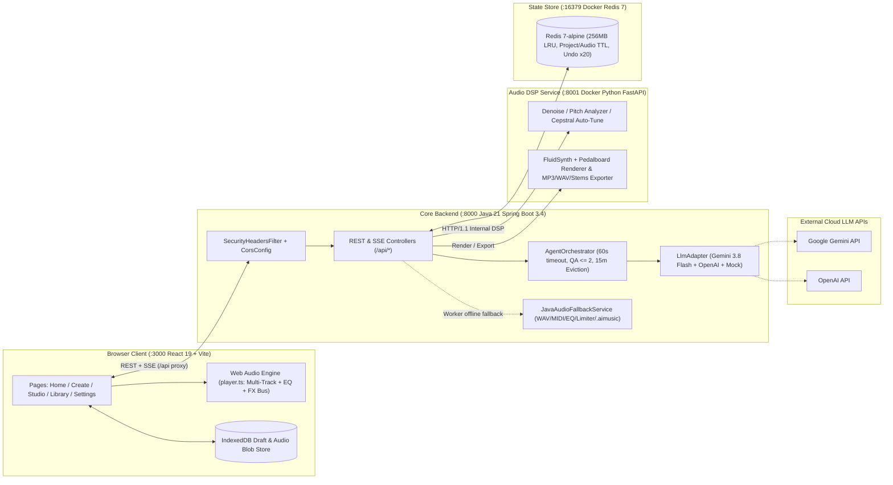
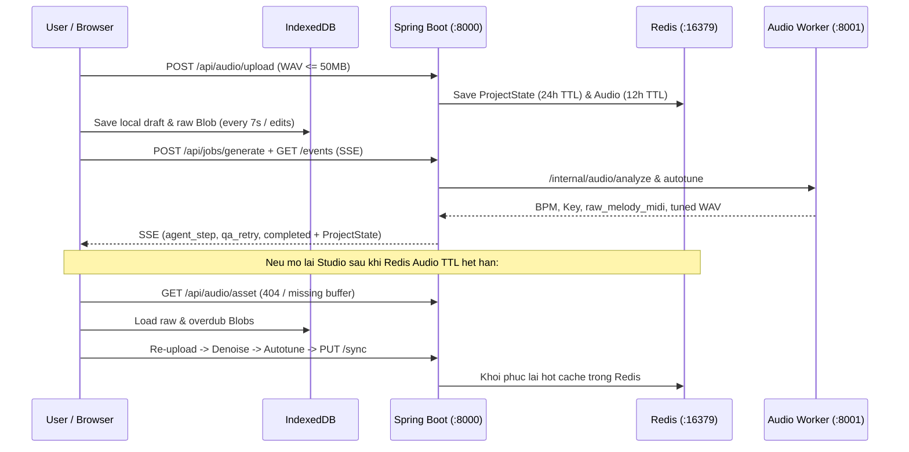
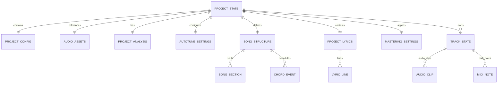

# Tài liệu Thiết kế Kiến trúc & Giao diện Hệ thống (`DESIGN_SPEC`)
## Dự án: AI Music Studio (Hybrid Multi-Agent DAW)

- **Phiên bản:** 2.1 (Option B Production + FL Playlist + Global Multimodal AI Copilot)
- **Cập nhật lần cuối:** 2026-11-23
- **Liên kết tài liệu:** [REQUIREMENTS.md](./REQUIREMENTS.md) | [SRS.md](./SRS.md) | [API_AND_UI_SPEC.md](./API_AND_UI_SPEC.md) | [MULTI_AGENT_ARCHITECTURE.md](./MULTI_AGENT_ARCHITECTURE.md)

---

## 1. Kiến trúc Hệ thống Tổng thể (Option B — 4 Tiers)

---

## 2. Thiết kế Luồng Dữ liệu & Phục hồi (`Sequence Diagrams`)

### 2.1. Luồng Phối khí, Auto-Rehydrate TTL & Studio Loop

---

## 3. Thiết kế Mô hình Dữ liệu (`Shared Project State`)

*Quy ước chính của Schema:*
- **`TrackState`** hỗ trợ cả `"audio"` (`clips[]`) và `"midi"` (`instrument`, `notes[]`), cùng dùng chung bộ Mixer + DSP (`volume`, `pan`, `low_db`, `mid_db`, `high_db`, `reverb_send`, `delay_send`, `mute`, `solo`, `locked`).
- **`SongSection`** (`name`, `start_bar`, `bars`, `energy`, `has_user_motif`) điều khiển cả bố cục phối khí của `ArrangerAgent`, phân khúc khung Pattern MIDI, lẫn làn **Dynamics Automation Envelope** kéo chỉnh trực tiếp trên Playlist.

---

## 4. Thiết kế Giao diện & Hệ thống Component Frontend

### 4.1. Code-Splitting & Cấu trúc Module React
- **`App.tsx`:** Nạp lười (`React.lazy` + `Suspense`) toàn bộ 5 route (`HomePage`, `CreatePage`, `StudioPage`, `LibraryPage`, `SettingsPage`), giữ main chunk `index` gọn quanh ~304 kB.
- **`ProjectProvider.tsx`:** Quản lý trạng thái dự án thống nhất, bộ bảo vệ bất đồng bộ **`saveSeqRef`** (chống stale save ghi đè), và đồng bộ 2 tầng `IndexedDB` + `/api/projects/{id}/sync`.
- **`StudioPage.tsx` & các Module con:**
  - `QuickStudioView.tsx`: Chế độ nghe thử gọn, đổi Genre/Mood/BPM và Regenerate 1 chạm.
  - `TimelineEditor.tsx` + `WaveformClipCanvas.tsx`: Playlist đa làn chuẩn **FL Studio 12 Clip Frame**.
  - `StepSequencer.tsx`: Lưới trống hỗ trợ `4/4` (16 bước) và `3/4` / `6/8` (12 bước).
  - `PianoRollEditor.tsx`: Bộ soạn nốt C1–C7, Scale highlight, Quantize, Velocity lane, Copy/Paste nốt.
  - `ConsoleMixerPanel.tsx`: Kênh trộn dọc 3-Band EQ, FX Send (`BUS A Reverb` + `BUS B Delay`), LED Meter và Master Bus.
  - `AiCoachChatDrawer.tsx`: Ngăn kéo **AI Music Copilot** toàn cục trên cả 5 trang (`AppShell.tsx` + `ProjectProvider.tsx`), hỗ trợ SSE Stream, Mic WAV / Speech & đính kèm Audio (`<= 10 MB`), **Áp dụng tất cả**, **Hoàn tác 1 chạm (`Revert`)** và lưu hội thoại trong `IndexedDB` (`chat_threads`).

### 4.2. Quy chuẩn Thẩm mỹ DAW & Khung Clip FL Studio 12
- **Bảng màu nền Hardware Dark:**
  - Studio Shell `#111317`, Sidebar `#16191f`, Panel `#1b1e25`, Lane nền phân cụm 4 ô nhịp `#1c2331` / `#131822`, đường chia Beat `rgba(255,255,255,0.045)`, Playhead xanh lá `#4ade80`.
- **Cấu trúc 3 loại Khung Clip trên Playlist (`17px Header + Thân bán trong suốt thấy lưới nhịp`):**
  1. **Audio Waveform (`Vocal`, `Overdub`, `Texture`):** Header màu đặc (`#3c9678` / `#aa4562` / `#4f679e`) + biểu tượng sóng `∿`; thân vẽ **đa giác sóng đối xứng liên tục** (`WaveformClipCanvas`) tối đa `480` mẫu kèm Fade-In/Out chéo và progress xanh khi phát.
  2. **Automation Envelope (`Dynamics`):** Header xanh thép (`#4a6592`) + icon spline `⟋`; thân vẽ đường cong SVG gradient thể hiện `section.energy` cùng chấm neo kéo trực tiếp (lưu qua Undo/Redo).
  3. **MIDI Pattern (`Drums`, `Bass`, `Harmony`, `Lead`):** Tự động cắt khung theo từng `SongSection` hoặc cụm 4 ô nhịp (tự gắn biến thể `#2`, `#3` khi họa tiết nốt đổi); header đặc (`#9d6f2c` / `#6e56a4` / `#4c76a8` / `#388680`) + icon Pattern + Piano Roll thu gọn bên trong.

---

## 5. Thiết kế AI Copilot Toàn Diện & An Toàn Hệ Thống

### 5.1. Kiến trúc Global AI Music Copilot (`4 Modes + Mini-RAG + Multimodal + Tool Calling`)
- **4 chế độ chuyên biệt (`CoachAssistantMode`) gắn vào `AppShell` toàn app (`/`, `/create`, `/library`, `/settings`, `/studio/:id`):**
  1. `producer`: Điều hướng trang, khởi tạo Starter Template từ Home, đánh giá cấu trúc, BPM, đặt mô-típ Chorus, Overdub & Fit Check.
  2. `arrangement`: Gợi ý tiến trình hợp âm (`vi - IV - I - V`, ...), đổi nhịp `4/4|3/4|6/8`, thêm đoạn (`Bridge`), kéo **Dynamics Energy%**, tái tạo track trống/bass/đệm.
  3. `lyricist`: Viết hoặc sửa từng dòng lời Việt/Anh/Song ngữ khớp mật độ nốt/âm tiết (`update_lyrics_lines`, `suggest_lyrics`).
  4. `mix`: Tư vấn & chỉnh trực tiếp **3-Band EQ (`low_db`, `mid_db`, `high_db`)**, `volume`, `pan`, **FX Sends (`reverb_send`, `delay_send`)**, Auto-Tune preset, Auto-Trim & Auto-Mix `-1.0 dBFS`.
- **Mini-RAG & Native Tool Calling:**
  - `DawPlaybook.java` chuẩn hóa tiếng Việt không dấu (NFD) để truy hồi playbook hỗn hợp (`route`, `query`, `mode`) và truyền cùng full snapshot (`tracks`, EQ, FX, lyrics, sections, `fit_check`) vào LLM.
  - `LlmAdapter.generateWithTools` / `generateAudioWithTools` gọi native Gemini `functionDeclarations` (kèm `inlineData` audio `<= 6 MB`) hoặc OpenAI `tools` (tự chuyển JSON Schema `type` về lowercase) với **13+ Action Tools**, plus `/api/coach/chat/stream` (SSE) và `/api/coach/chat/audio` (`<= 10 MB`, có **Java DSP Telemetry** đo RMS/Peak dBFS khi fallback Mock).
- **Cơ chế An toàn (`Human-in-the-loop` + 1-Click Revert & IndexedDB Thread Memory):**
  - AI chỉ đề xuất mảng `suggested_actions[]` (`set_track_mix`, `edit_structure_and_dynamics`, `update_lyrics_lines`, `suggest_lyrics`, `rearrange_chords`, `apply_autotune`, `auto_mix`, `auto_trim_vocal`, `regenerate_track`, `update_config`, `navigate_tab`, `create_template`, `export_project`, `test_health`).
  - Không tự ý sửa `ProjectState`; người dùng bấm từng nút hoặc **Áp dụng tất cả**, đồng thời snapshot trước khi chạy được giữ lại cho nút **`Hoàn tác` (1-Click Revert)**. Lịch sử chat lưu bền vững trong store `chat_threads` (`IndexedDB v2`).
- **Model & Fallback Resilience (`LlmAdapter.java`):**
  - Mặc định gọi **`gemini-3.8-flash`** qua header `x-goog-api-key` (hỗ trợ cả key `AQ...` lẫn `AIza...`); nếu model cấu hình trả `404` sẽ tự fallback sang `gemini-3.8-flash`, và nếu chưa cấu hình API Key hoặc quá tải cloud sẽ tự rơi mượt về bộ phân tích Heuristic + DSP Audio Telemetry cục bộ.

### 5.2. Kiến trúc Phòng thủ Bảo mật (Local Hardening Layers)
- **Transport & Headers:** Cổng Docker `audio-worker` & `backend` bind về `127.0.0.1`; mọi HTTP response gắn `SecurityHeadersFilter` (`nosniff`, `DENY`, `no-referrer`, `Permissions-Policy`); `CorsConfig` giới hạn local origins.
- **Upload & DoS Bounds:** Kiểm tra `file.getSize()` trước khi đọc vào RAM (`<= 55 MB` Servlet, `_read_upload_bounded` `413` trên Python worker); kiểm soát Zip Bomb (`<= 64 entries`, `<= 60 MB/entry`, `<= 120 MB` tổng); chặn `total_bars > 256` (`HTTP 400`) trước khi cấp phát mảng render và lazy-allocate Reverb/Delay FX bus.
- **Bảo vệ Dữ liệu & Key:** Che toàn bộ key dạng `AIza...` / `sk-...` / `AQ...` / `key=...` trong thông báo lỗi HTTP ở `LlmAdapter`; import `.aimusic` mặc định `overwrite=false` tránh đè mất bài trùng ID.
