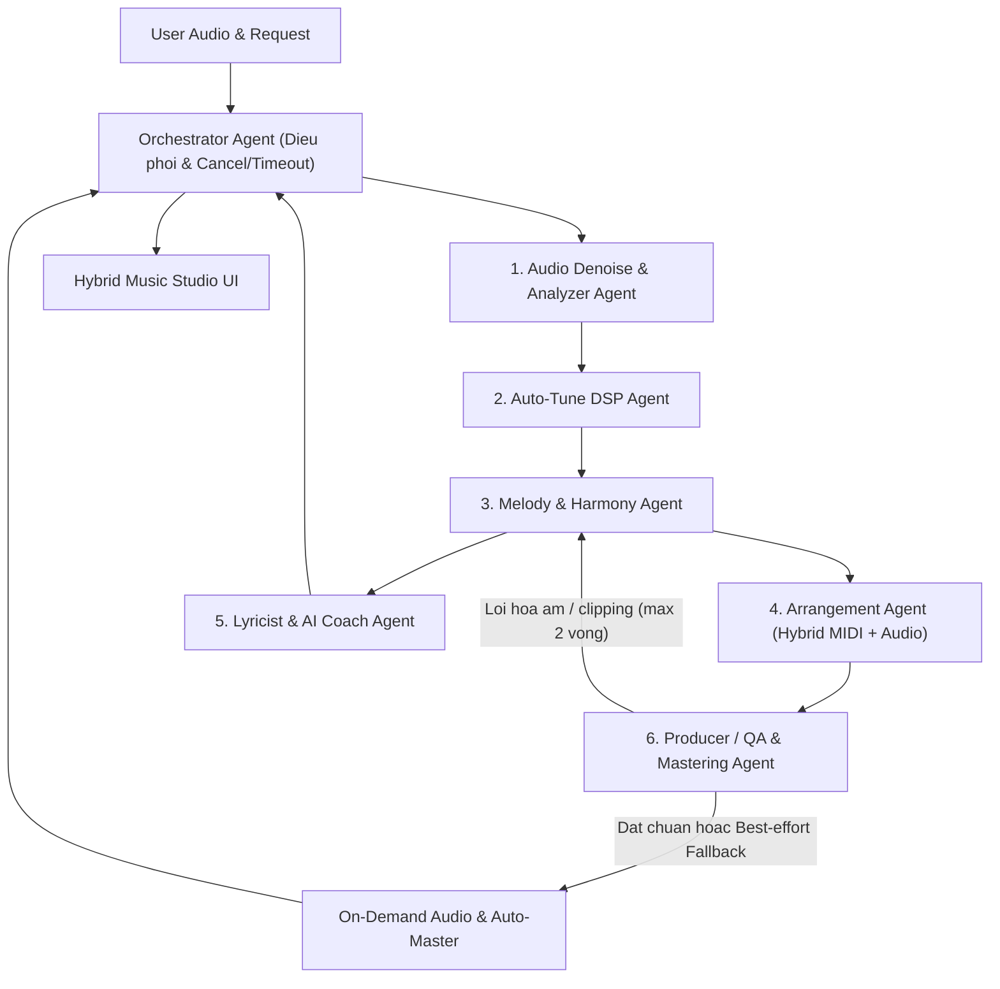

# Tài liệu Kiến trúc Multi-Agent & Thiết kế Kỹ thuật
## Dự án: AI Music Studio (Hum-to-Music + Auto-Tune + DAW-lite)

- **Phiên bản:** 1.2 (Complete Baseline + Infra & API Linked)
- **Liên kết:** [SRS.md](./SRS.md) | [API_AND_UI_SPEC.md](./API_AND_UI_SPEC.md)
- **Phạm vi:** Ứng dụng **Single-User Local App** (cá nhân, không phân quyền), tối ưu lưu trữ nhẹ ổ đĩa bằng Redis + MIDI JSON.
- **Mục tiêu tài liệu:** Định nghĩa cách các AI Agent phối hợp với nhau, cấu trúc dữ liệu dùng chung (`Shared State`), cơ chế kết hợp **MIDI + Audio Clips**, kiến trúc lưu trữ nhẹ đĩa, và lộ trình triển khai từ MVP đến bản hoàn chỉnh.

---

## 1. Nguyên lý Thiết kế Cốt lõi: Hybrid LLM + DSP Architecture

Trong bài toán âm nhạc, một LLM thuần túy không thể tự xử lý sóng âm (waveform) ở mức sample hay kéo cao độ giọng hát mượt mà. Vì vậy, hệ thống áp dụng mô hình **Hybrid Multi-Agent**:
* **LLM Agents (Bộ não sáng tạo & điều phối):** Hiểu yêu cầu ngôn ngữ, lập kế hoạch cấu trúc bài hát, viết tiến trình hợp âm (chord progression), phát triển giai điệu tượng trưng (MIDI / Note JSON), chọn nhạc cụ, và kiểm tra chéo (QA) logic âm nhạc.
* **DSP & Audio Engines (Công cụ thực thi âm thanh):** Các module xử lý tín hiệu số chuyên dụng (đóng vai trò **Tools** mà Agent gọi) để tách cao độ (Pitch Extraction), chỉnh phô (Auto-Tune), lượng tử hóa nhịp, tổng hợp MIDI thành Audio (SoundFont/VST/Audio Gen) và trộn đa track (Mixing/Export).

---

## 2. Sơ đồ Điều phối Multi-Agent

Hệ thống kết hợp 3 mô hình: **Orchestrator** (điều phối trung tâm), **Pipeline** (xử lý tuần tự từ audio thô sang nhạc hoàn chỉnh) và **Maker–Checker Loop** (kiểm duyệt hòa âm/nhịp trước khi xuất cho người dùng, tối đa 2 vòng + Timeout 60s/bước).



---

## 3. Vai trò & Đặc tả Chi tiết Từng Agent

### 3.1. `Orchestrator Agent` (Nhạc trưởng / Điều phối viên)
* **Vai trò:** Tiếp nhận yêu cầu từ người dùng (tạo mới toàn bộ, chuyển chế độ `Preserve`/`Enhance`, bật `Auto-Tune`, hỏi `AI Coach`, hoặc chỉ `Regenerate` 1 track) và kích hoạt đúng nhánh Agent cần thiết.
* **Quản lý Timeout & Hủy (Cancel):** Áp đặt giới hạn **tối đa 60 giây** mỗi bước tạo nhạc, hỗ trợ hủy job ngay lập tức khi người dùng bấm Cancel và lưu trạng thái vào Redis.

### 3.2. `Audio Denoise & Analyzer Agent` (Tiền xử lý & Phân tích Âm thanh)
* **Input:** Raw Audio (`WAV/MP3/...` từ Mic hoặc Upload).
* **Tools sử dụng:**
  * **AI Denoise / Vocal Isolation:** DeepFilterNet / RNNoise / Demucs (nhẹ) để tách tiếng ồn phòng hoặc nhạc nền lẫn vào, tạo bản `dry_denoised.wav` sạch nhưng giữ nguyên `raw_input.wav` cho việc đối chiếu.
  * **Pitch & Rhythm Analyzer:** CREPE / pYIN / Basic-Pitch + librosa để bắt cao độ, BPM, Key/Scale.
  * **AI Auto-Trim:** Phát hiện khoảng lặng thừa đầu/cuối và đề xuất điểm cắt khớp ô nhịp 1.
* **Output cập nhật vào State:** `bpm`, `time_signature`, `detected_key`, `scale`, `raw_melody_notes`, `dry_denoised_url`.

### 3.3. `Auto-Tune DSP Agent` (Kỹ sư Chỉnh phô Giọng hát)
* **Input:** `dry_denoised.wav` (hoặc `raw_input.wav`) + `detected_key` + Cấu hình Auto-Tune (`preset`, `retune_speed_ms`, `humanize`, `mix_percent`).
* **Tools sử dụng:** Pitch-shifting & Formant-preserving DSP engine (WORLD Vocoder / PyTSMod / Rubberband).
* **Hoạt động:**
  1. Nếu người dùng chọn chế độ **Nghe giọng mộc + Beat**: Bỏ qua Auto-Tune, đưa thẳng `dry_denoised.wav` vào mix để kiểm tra độ khớp tự nhiên.
  2. Nếu bật Auto-Tune: Kéo nốt về `Scale` (hoặc theo hợp âm hiện tại) dựa trên `retune_speed_ms` và giữ độ rung theo `humanize`, bảo toàn formant giọng hát.

### 3.4. `Melody & Harmony Agent` (Nhạc sĩ Sáng tác & Hòa âm)
* **Input:** `raw_melody_notes`, `bpm`, `key`, `melody_mode` (`preserve` | `enhance`), `output_mode` (`accompaniment` | `full_song`), `motif_position` (`chorus` mặc định | `verse` | `auto`), `genre`, `mood`, `user_prompt`.
* **Nhiệm vụ theo chế độ:**
  * `preserve`: Giữ nguyên `raw_melody_notes`, thiết kế `chord_progression` bám sát các nốt mạnh của giai điệu gốc.
  * `enhance`: Tinh chỉnh cao độ/tiết tấu mượt mà hơn nhưng giữ mô-típ nhận diện cốt lõi.
  * `full_song`: Mặc định đặt câu ngân nga làm điểm nhấn của **Chorus** (hoặc vị trí do người dùng/AI đề xuất), mở rộng thành cấu trúc `Intro – Verse – Chorus – Bridge – Outro`.
* **Output:** `sections`, `chords_timeline`, `enhanced_melody_notes` (MIDI JSON).

### 3.5. `Arrangement Agent — Mô hình Hybrid (MIDI + Audio Clips)`
Để người dùng vừa **sửa từng nốt trên Piano Roll**, vừa **cắt ghép/di chuyển đoạn âm thanh như một DAW thông thường**, hệ thống phối hợp 2 loại dữ liệu song song:

1. **Symbolic MIDI Tracks (Cốt lõi — Drums, Bass, Harmony, Lead):**
   * Agent sinh nốt MIDI theo từng đoạn bài hát và dùng **Sampler / SoundFont chất lượng cao** để phát tiếng nhạc cụ.
   * *Ưu điểm:* Dung lượng cực nhẹ (chỉ vài KB JSON), sửa trực tiếp từng nốt trên Piano Roll, đổi nhạc cụ tức thì (Piano $\rightarrow$ Guitar), và tự cập nhật khi đổi hợp âm.
2. **Audio Clip Tracks (Lớp bổ sung — Vocal, AI Texture/Audio Gen, Sample):**
   * Chứa bản thu Vocal/Hum và (tùy chọn) các lớp âm thanh tự nhiên/atmosphere sinh từ AI Audio hoặc sample cắt ghép.
   * *Ưu điểm:* Trên Timeline Studio, người dùng thao tác **Split (cắt), Trim (kéo ngắn), Move (dịch thời gian), Fade In/Out, Loop** trên mọi clip (cả Audio Clip lẫn MIDI Clip) như các nền tảng làm nhạc phổ thông.

### 3.6. `Lyricist & AI Music Coach Agent` (Viết lời & Tư vấn Sáng tác)
* **Viết lời theo Beat:** Dựa vào `sections`, `bpm`, số nốt giai điệu và chủ đề/ngôn ngữ (Việt/Anh) để gợi ý lời bài hát khớp tiết tấu, hoặc hỗ trợ người dùng tự viết lời vào **Lyric Pad** ngay trên nền beat đang phát.
* **AI Music Coach (Hỏi đáp hướng dẫn):** Đọc toàn bộ ngữ cảnh dự án hiện tại để trả lời câu hỏi của người dùng (VD: *"Nên đặt câu ngân nga ở Chorus hay Verse?"*, *"Sửa đoạn chuyển hợp âm này cho buồn hơn?"*). Không tự ý ghi đè bài nhạc khi chưa có xác nhận của người dùng.

### 3.7. `Producer / QA & Auto-Mastering Agent` (Kiểm duyệt & Chống vỡ tiếng)
* **Kiểm duyệt Hòa âm (Maker–Checker):**
  * Kiểm tra tỷ lệ nốt khớp Key/Scale, dải tần Bass không đè Vocal, độ khớp độ dài các track, và đường cong năng lượng giữa `Verse` và `Chorus`.
  * Nếu lỗi nghiêm trọng $\rightarrow$ yêu cầu `Composer/Arranger` sửa lại (tối đa **2 vòng lặp**; nếu quá 2 vòng vẫn chưa hoàn hảo $\rightarrow$ trả về **Best-effort Fallback** kèm cảnh báo nhẹ).
* **AI Auto-Mix & Anti-Clipping:**
  * Tính toán tự động mức Gain từng track, nén/lách tần số nhẹ để giọng mộc/Auto-Tune không bị nhạc nền át.
  * Áp dụng **Master Limiter** giữ đỉnh tín hiệu đầu ra $\le -1.0\text{ dBFS}$ (`-14 LUFS`) và cảnh báo nếu người dùng chỉnh tay gây nguy cơ vỡ tiếng.
* **Vocal Overdub & AI Fit Check (Kiểm tra bản thu đè lên Beat):**
  * Khi người dùng thu hát đè trực tiếp lên nền Beat đang phát (có bù trễ mic), Agent kết hợp cùng `Audio Analyzer` đo độ lệch nhịp (`timing offset ms`), độ phô cao độ so với Key/Hợp âm tại ô nhịp đó và cân bằng âm lượng.
  * Trả về danh sách **Đề xuất chỉnh sửa kèm 1-Click Fix** (VD: dịch vị trí clip `±ms`, bật Auto-Tune sửa nốt cuối câu, hoặc cân Gain/EQ).

---

## 4. Cấu trúc Dữ liệu Dùng chung (`Shared Project State`) & Kiến trúc Lưu trữ Nhẹ Đĩa

### 4.1. Chiến lược Lưu trữ 2 Tầng: Chống Mất Bài khi Quên Lưu & Nhẹ Ổ Đĩa
Vì ứng dụng chạy cho **cá nhân trên máy có dung lượng đĩa hạn chế** nhưng vẫn phải đảm bảo **quên bấm Save mở lại vẫn còn**:

1. **Tầng 1 — Browser `IndexedDB` Auto-Save (Chống quên lưu):**
   * Frontend tự động lưu ngầm mỗi **5–10 giây** (hoặc ngay sau mỗi thao tác sửa/thu) toàn bộ `ProjectState` JSON và bản thu âm nén nhẹ (`OPUS/FLAC` chỉ ~200 KB–1 MB) vào `IndexedDB` của trình duyệt.
   * Áp dụng cơ chế **Rolling Cap (giữ tối đa 3–5 dự án gần nhất)** để tránh phình dung lượng. Khi bạn tắt web hay tắt máy mà quên lưu, lần sau mở web lại sẽ hiện hộp thoại **"Khôi phục dự án gần nhất"** và đồng bộ ngược lại vào Redis!
2. **Tầng 2 — Redis (In-Memory + TTL tự hết hạn):**
   * Lưu `ProjectState`, lịch sử Undo (15–20 bước), Job Queue của Multi-Agent và cache preview nóng trong RAM với tốc độ mili-giây.
3. **File Dự án Di động `.aimusic` + MIDI-First:**
   * Các track nhạc cụ lưu thuần túy dưới dạng **MIDI JSON (vài KB)**, render audio theo nhu cầu. Khi cần cất giữ lâu dài, bấm **Save `.aimusic`** để xuất 1 file gọn nhẹ (`1–3 MB`), không lưu hàng loạt WAV stems rác trên ổ cứng.

### 4.2. Schema `Shared Project State`

```json
{
  "project_id": "proj_20261117_001",
  "version": 3,
  "config": {
    "melody_mode": "enhance",
    "output_mode": "full_song",
    "motif_position": "chorus",
    "genre": "Pop Ballad",
    "mood": "Emotional",
    "user_prompt": "Thêm tiếng piano nhẹ ở Intro và bùng nổ ở Chorus"
  },
  "audio_assets": {
    "raw_input_ref": "mem://raw/input.flac",
    "dry_denoised_ref": "mem://processed/dry_denoised.wav",
    "tuned_vocal_ref": "mem://processed/vocal_autotuned.wav"
  },
  "analysis": {
    "bpm": 92,
    "time_signature": "4/4",
    "detected_key": "C",
    "detected_scale": "major",
    "raw_melody_midi": [
      { "pitch": 60, "start_beat": 0.0, "duration": 1.0, "velocity": 85 }
    ]
  },
  "autotune_settings": {
    "enabled": true,
    "preset": "natural",
    "key": "C",
    "scale": "major",
    "retune_speed_ms": 35,
    "humanize": 0.6,
    "mix_percent": 100,
    "auto_follow_project_key": true
  },
  "song_structure": {
    "total_bars": 32,
    "sections": [
      { "name": "Intro", "start_bar": 1, "bars": 4, "energy": 0.3 },
      { "name": "Verse 1", "start_bar": 5, "bars": 8, "energy": 0.5 },
      { "name": "Chorus", "start_bar": 13, "bars": 8, "energy": 0.9, "has_user_motif": true }
    ],
    "chords": [
      { "bar": 1, "beat": 1, "symbol": "C", "duration_beats": 4 },
      { "bar": 2, "beat": 1, "symbol": "G", "duration_beats": 4 }
    ]
  },
  "lyrics": {
    "language": "vi",
    "lines": [
      { "section": "Chorus", "bar": 13, "text": "Nhung giai dieu con vang mai trong tim..." }
    ]
  },
  "tracks": {
    "vocal": {
      "type": "audio", "locked": false, "mute": false, "solo": false, "volume": 0.9, "pan": 0.0,
      "clips": [
        { "id": "clip_v1", "source": "tuned_vocal_ref", "start_bar": 13, "trim_start_sec": 0.2, "fade_in_ms": 20 }
      ]
    },
    "drums": { "type": "midi", "locked": false, "instrument": "acoustic_kit", "notes": [] },
    "bass": { "type": "midi", "locked": false, "instrument": "finger_bass", "notes": [] },
    "harmony": { "type": "midi", "locked": false, "instrument": "grand_piano", "notes": [] },
    "lead": { "type": "midi", "locked": false, "instrument": "electric_piano", "notes": [] }
  },
  "mastering": {
    "auto_mix_enabled": true,
    "limiter_ceiling_db": -1.0,
    "target_lufs": -14.0
  },
  "qa_status": {
    "approved": true,
    "iterations": 1,
    "fallback_used": false,
    "feedback": "Hòa âm và mật độ nhạc cụ khớp cấu trúc bài."
  }
}
```

---

## 5. Giao thức Tái tạo Cục bộ (Partial Regeneration trong Studio)

Để hỗ trợ yêu cầu Studio nâng cao (`FR-STU-07`, `FR-STU-08` và `FR-STU-11`), kiến trúc hỗ trợ 5 mức chạy lại mà không phá hỏng công sức chỉnh sửa của người dùng:

1. **Đổi thông số Denoise / Auto-Tune / Nghe giọng mộc:** Chỉ chạy lại `Auto-Tune DSP Agent` hoặc đổi source về `dry_denoised_ref` $\rightarrow$ cập nhật mixer tức thì.
2. **Cắt ghép / Kéo dịch Clip trên Timeline:** Cập nhật mảng `clips` trong State (không cần gọi LLM, hỗ trợ Undo ngay qua Redis & IndexedDB).
3. **Thu đè lên Beat (Overdubbing) & AI Fit Check:** Ghi clip mới vào track Vocal (bù trễ mic) $\rightarrow$ chạy `Analyzer + Producer/Coach` trả về đề xuất chỉnh nhịp/cao độ/Gain $\rightarrow$ áp dụng các đề xuất người dùng bấm chọn.
4. **Bấm Regenerate riêng 1 Track (VD: Bass):** `Orchestrator` khóa toàn bộ `sections`, `chords` và các track khác, chỉ gửi ngữ cảnh hiện tại cho `Arrangement Agent` sinh lại track `bass` $\rightarrow$ `QA Agent` kiểm tra khớp nhịp/hợp âm với các track đang khóa.
5. **Sửa Hợp âm trên Timeline / Sửa Nốt trên Piano Roll:**
   * Nếu sửa nốt trên Piano Roll: Cập nhật trực tiếp `tracks[x].notes` (không cần gọi LLM).
   * Nếu sửa Hợp âm và bấm *Re-arrange*: Gọi `Arrangement Agent` cập nhật lại `bass` & `harmony` bám theo hợp âm mới (giữ nguyên các track đã bật `locked: true`).

---

## 6. Đề xuất Tech Stack & Dual LLM Provider (Gemini + OpenAI)

| Tầng hệ thống | Công nghệ đề xuất | Lý do lựa chọn |
| :--- | :--- | :--- |
| **Tầng chạy & Đóng gói (Infra)** | **Node.js v24** (Frontend) + **Docker Compose** (`FastAPI` + `redis:7-alpine`) | Máy đã có sẵn Node & Docker; chạy Backend Python DSP, FFmpeg, FluidSynth và Redis trong Docker giúp không cần cài rác lên ổ `C:`, dễ dọn dẹp và cô lập thư viện. |
| **Frontend (Studio & UI)** | **Next.js / React + TypeScript** + **Web Audio API / Tone.js** + **`IndexedDB`** | Ghi âm mic, thu đè (Overdub), phát đa track đồng bộ, Timeline cắt ghép clip, Piano Roll và **Auto-Save ngầm chống mất bài khi quên lưu**. |
| **Backend API & Realtime** | **Python (FastAPI)** + **WebSocket / SSE** | Hệ sinh thái xử lý âm thanh và AI trên Python mạnh nhất; đẩy tiến trình từng Agent & hỗ trợ nút Cancel job ngay lập tức. |
| **State, Undo & Cache** | **Redis** (kèm TTL tự dọn) | Lưu `ProjectState`, Undo snapshots và Job Queue trong RAM cực nhanh, giải quyết bài toán không làm phình ổ cứng. |
| **LLM Providers (Cloud API)** | **Google Gemini API** + **OpenAI API** (qua Adapter thống nhất) | Không tốn GB ổ đĩa chứa model local; linh hoạt chọn hoặc kết hợp Gemini (ngữ cảnh rộng, viết lời Việt tốt) và OpenAI (JSON có cấu trúc, điều phối). |
| **Multi-Agent Orchestration** | **LangGraph** (hoặc Custom State Machine + `google-genai` / `openai` SDK) | Kiểm soát chặt `ProjectState`, hỗ trợ rẽ nhánh (`Preserve`/`Enhance`, tái tạo 1 track, AI Coach) và vòng lặp `QA Reviewer` có timeout 60s. |
| **Denoise, Analysis & Auto-Tune DSP** | `DeepFilterNet` / `noisereduce` (Denoise), `librosa` + `basic-pitch`/`crepe` (Pitch-to-MIDI), `pyworld` / `rubberband` (Auto-Tune) | Chạy ổn định trên máy cá nhân, lọc nhiễu tốt và giữ formant giọng hát tự nhiên. |
| **Rendering, Mastering & Export** | `FluidSynth` + SoundFont (`.sf2`), `pedalboard` (Spotify DSP: EQ/Compressor/Limiter), `ffmpeg`, `mido` / `pretty_midi` | Render MIDI nhẹ, áp dụng Anti-Clipping Limiter (`<= -1.0 dBFS`), xuất `.aimusic`, `WAV/MP3/Stems/MIDI`. |

---

## 7. Hướng dẫn Lấy & Cấu hình API Key (Gemini & OpenAI)

Để chạy hệ thống mà không cần tải model AI nặng về máy, bạn chỉ cần lấy API Key từ 1 hoặc cả 2 nhà cung cấp sau:

1. **Cách lấy Gemini API Key (Google AI Studio):**
   * Truy cập **Google AI Studio**: `https://aistudio.google.com/` và đăng nhập bằng tài khoản Google.
   * Chọn mục **Get API key** $\rightarrow$ bấm **Create API key** (chọn dự án Google Cloud có sẵn hoặc tạo mới).
   * Sao chép key (dạng `AIza...`). Lưu ý: Gemini có gói Free Tier để thử nghiệm trước, khi chạy nhiều có thể bật Billing (Pay-as-you-go).
2. **Cách lấy OpenAI API Key (OpenAI Platform):**
   * Truy cập **OpenAI Platform**: `https://platform.openai.com/` và đăng nhập.
   * Vào mục **Dashboard $\rightarrow$ API keys** (hoặc Settings $\rightarrow$ API keys) $\rightarrow$ bấm **Create new secret key**.
   * Đặt tên key, sao chép ngay key (dạng `sk-...`) vì OpenAI chỉ hiển thị một lần.
   * Vào **Settings $\rightarrow$ Billing** để nạp credit tối thiểu (OpenAI API tính phí tách biệt với gói ChatGPT Plus).
3. **Cách gắn vào dự án an toàn:**
   * Tạo file `.env` ở thư mục gốc dự án (và đưa `.env` vào `.gitignore` để không bao giờ lộ key):
     ```env
     GEMINI_API_KEY=your_gemini_api_key_here
     OPENAI_API_KEY=your_openai_api_key_here
     DEFAULT_LLM_PROVIDER=gemini   # hoặc openai
     ```
   * Trong giao diện Settings của ứng dụng cũng có thể cho phép chọn nhà cung cấp mặc định hoặc phân vai (VD: `Lyricist` dùng Gemini, `QA/Composer` dùng OpenAI hoặc Gemini).

---

## 8. Lộ trình Triển khai Đề xuất (Phased Roadmap)

Để kiểm soát rủi ro kỹ thuật và sớm có sản phẩm chạy thử, dự án nên triển khai theo **3 giai đoạn**:

* **Phase 1 — MVP Core Pipeline:**
  * Single-User Local App + Dual LLM Adapter (Gemini / OpenAI) + Auto-Save `IndexedDB` + Redis State/TTL.
  * Record/Upload $\rightarrow$ `AI Denoise` + `Audio Analyzer Agent` (BPM, Key, Pitch) + nghe **Giọng mộc (Dry Check)**.
  * `Auto-Tune Agent` (Quick Presets) + `Hum-to-Music` (*Preserve* + *Accompaniment Only*).
  * Quick Preview (so sánh Giọng mộc + Beat / Auto-Tune / AI Mix) + Auto-Limiter + Tải MP3/WAV.
* **Phase 2 — Full Song, Hybrid Clips, Overdub & Lyric/Coach:**
  * Bổ sung *AI Enhance Melody*, *Full Song Structure* (mặc định đặt mô-típ tại Chorus) + `Lyricist & AI Coach Agent`.
  * Hybrid Studio: Multi-Track Mixer (`M/S`, `Lock`, `Volume`, `Pan`), cắt ghép/kéo dịch clip (`Split/Trim/Move`), **Thu đè Overdub + AI Fit Check**, Regenerate từng track, xuất Stems & `.aimusic`.
  * `Producer / QA Agent` kiểm tra hòa âm tự động (max 2 vòng + Best-effort Fallback).
* **Phase 3 — Pro DAW-lite & Auto-Tune Chuyên sâu:**
  * Giao diện **Piano Roll** chỉnh nốt MIDI trực tiếp, **Chord Timeline** cho phép sửa hợp âm từng ô nhịp.
  * Bảng điều khiển Auto-Tune Pro (Key/Scale thủ công, Retune Speed, Humanize, Dry/Wet Mix, Auto-Follow).
  * AI Auto-Mix hoàn chỉnh và xuất file `.mid` đa track chuẩn DAW.
