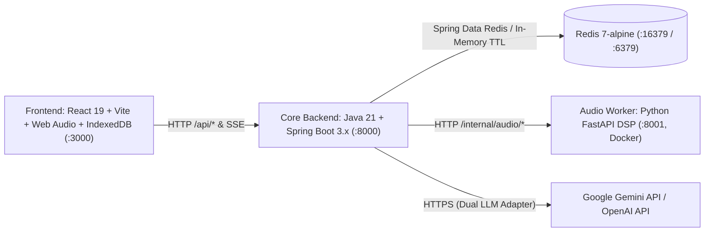
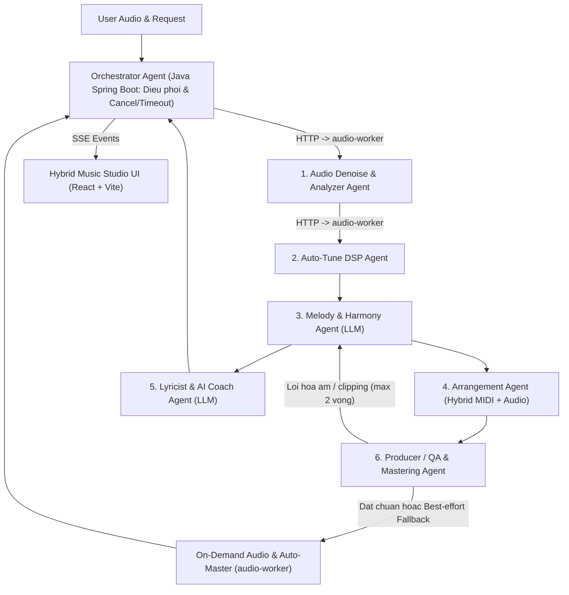

# Tài liệu Kiến trúc Multi-Agent & Thiết kế Kỹ thuật
## Dự án: AI Music Studio (Hum-to-Music + Auto-Tune + DAW-lite)

- **Phiên bản:** 2.3 (Phase 1–8 Complete: Pro DAW, 24-Tool Copilot, Stem Separation, Automation, Pitch Curve, WebMIDI, Custom `.sf2`, Hybrid Cloud SaaS)
- **Liên kết:** [REQUIREMENTS.md](./REQUIREMENTS.md) | [DESIGN_SPEC.md](./DESIGN_SPEC.md) | [SRS.md](./SRS.md) | [API_AND_UI_SPEC.md](./API_AND_UI_SPEC.md) | [TASK_BOARD.md](./TASK_BOARD.md)
- **Phạm vi:** Ứng dụng **Single-User Local App** (cá nhân, không phân quyền), tối ưu lưu trữ nhẹ ổ đĩa bằng Redis + MIDI JSON.
- **Mục tiêu tài liệu:** Định nghĩa cách các AI Agent phối hợp với nhau, cấu trúc dữ liệu dùng chung (`Shared State`), cơ chế kết hợp **MIDI + Audio Clips**, kiến trúc tách lớp Java Spring Boot + Python DSP Worker, kiến trúc lưu trữ nhẹ đĩa, và lộ trình triển khai từ MVP đến bản hoàn chỉnh.

---

## 1. Nguyên lý Thiết kế Cốt lõi: Hybrid LLM + DSP Architecture

Trong bài toán âm nhạc, một LLM thuần túy không thể tự xử lý sóng âm (waveform) ở mức sample hay kéo cao độ giọng hát mượt mà. Vì vậy, hệ thống áp dụng mô hình **Hybrid Multi-Agent** tách bạch 2 tầng thực thi:
* **Core Orchestrator & LLM Agents (`Java 21 + Spring Boot 3.x`):** Tiếp nhận toàn bộ API/SSE từ Frontend, quản lý `Shared Project State` trên Redis, gọi Dual LLM (**Gemini + OpenAI**) để lập kế hoạch cấu trúc bài hát, viết tiến trình hợp âm (chord progression), phát triển giai điệu tượng trưng (MIDI / Note JSON), chọn nhạc cụ, và kiểm tra chéo (QA) logic âm nhạc.
* **DSP & Audio Worker (`Python FastAPI` trong Docker + Pure-Java Fallback):** Microservice chuyên biệt đóng vai trò **Tools** mà Spring Boot gọi qua HTTP nội bộ (`AUDIO_WORKER_URL`) để tách nhiễu (`noisereduce`), trích xuất cao độ/BPM/Key (`librosa`), chỉnh phô (`Auto-Tune`), tổng hợp MIDI thành Audio (`FluidSynth` + SoundFont), và trộn đa track/Master Limiter (`pedalboard`/`FFmpeg`). Khi chạy cục bộ không bật Docker worker, Spring Boot có `JavaAudioFallbackService` đảm bảo hệ thống vẫn hoạt động trơn tru.



---

## 2. Sơ đồ Điều phối Multi-Agent

Hệ thống kết hợp 3 mô hình: **Orchestrator** (điều phối trung tâm), **Pipeline** (xử lý tuần tự từ audio thô sang nhạc hoàn chỉnh) và **Maker–Checker Loop** (kiểm duyệt hòa âm/nhịp trước khi xuất cho người dùng, tối đa 2 vòng + Timeout 60s/bước).



---

## 3. Vai trò & Đặc tả Chi tiết Từng Agent

### 3.1. `Orchestrator Agent` (Nhạc trưởng / Điều phối viên — `AgentOrchestrator.java`)
* **Vai trò:** Tiếp nhận yêu cầu từ người dùng (tạo mới toàn bộ, chuyển chế độ `Preserve`/`Enhance`, bật `Auto-Tune`, hỏi `AI Coach`, hoặc chỉ `Regenerate` 1 track) và kích hoạt đúng nhánh Agent cần thiết.
* **Quản lý Timeout & Hủy (Cancel):** Áp đặt giới hạn **tối đa 60 giây** mỗi bước tạo nhạc, hỗ trợ hủy job ngay lập tức khi người dùng bấm Cancel (`POST /api/jobs/{jobId}/cancel`), phát tiến trình qua SSE (`SseEmitter`) và lưu trạng thái vào Redis (hoặc In-Memory TTL fallback).

### 3.2. `Audio Denoise & Analyzer Agent` (Tiền xử lý & Phân tích Âm thanh — `audio-worker`)
* **Input:** Raw Audio (`WAV/MP3/M4A/OGG/FLAC` từ Mic hoặc Upload).
* **Tools sử dụng (tại `audio-worker` + fallback Java):**
  * **AI Denoise / Vocal Isolation:** `noisereduce` / spectral gating để tách tiếng ồn phòng, tạo bản `dry_denoised.wav` sạch nhưng giữ nguyên `raw_input.wav` cho việc đối chiếu.
  * **Pitch & Rhythm Analyzer:** `librosa` (`pyin` / beat tracking) để bắt cao độ, BPM (`40–220`), Key/Scale (`C..B`, `major`/`minor`) và `raw_melody_midi`.
  * **AI Auto-Trim:** Phát hiện khoảng lặng thừa đầu/cuối và cắt gọn khớp ô nhịp.
* **Output cập nhật vào State:** `bpm`, `time_signature`, `detected_key`, `detected_scale`, `raw_melody_midi`, `dry_denoised_ref`.

### 3.3. `Auto-Tune DSP Agent` (Kỹ sư Chỉnh phô Giọng hát — `audio-worker`)
* **Input:** `dry_denoised.wav` (hoặc `raw_input.wav`) + `detected_key` + Cấu hình Auto-Tune (`preset`, `retune_speed_ms`, `humanize`, `mix_percent`, `auto_follow_project_key`).
* **Tools sử dụng:** Pitch-shifting OLA giữ thời lượng + **bảo toàn Formant bằng Cepstral Spectral Envelope (`preserve_formant=true`)** tại `audio-worker` (và formant tilt EQ trên `JavaAudioFallbackService`), kèm `key_to_pitch_class()` chuẩn hóa cả dấu thăng và giáng như `Eb`, `Ab`, `Bb`.
* **Hoạt động:**
  1. Nếu người dùng chọn chế độ **Nghe giọng mộc + Beat** (`off`): Bỏ qua Auto-Tune, đưa thẳng `dry_denoised.wav` vào mix để kiểm tra độ khớp tự nhiên.
  2. Nếu bật Auto-Tune (`natural`, `balanced`, `modern`): Kéo nốt về `Scale` dựa trên `retune_speed_ms` (`0–200 ms`), giữ độ rung theo `humanize`, giữ nguyên âm sắc formant giọng hát, và tự re-tune khi đổi Project Key nếu bật `auto_follow_project_key`.

### 3.4. `Melody & Harmony Agent` (`ComposerAgent.java`)
* **Input:** `raw_melody_midi`, `bpm`, `time_signature` (`4/4` | `3/4` | `6/8`), `key`, `melody_mode` (`preserve` | `enhance`), `output_mode` (`accompaniment` | `full_song`), `add_count_in_tail`, `motif_position` (`chorus` mặc định | `verse` | `auto`), `genre`, `mood`, `user_prompt` (qua bộ lọc bản quyền `MusicTheory` cho nghệ sĩ/bài hát).
* **Nhiệm vụ theo chế độ:**
  * `preserve`: Giữ nguyên `raw_melody_midi`, thiết kế `chords` bám sát các nốt mạnh của giai điệu gốc.
  * `enhance`: Tinh chỉnh cao độ/tiết tấu mượt mà hơn nhưng giữ mô-típ nhận diện cốt lõi.
  * `accompaniment` + `add_count_in_tail`: Bổ sung `Count-in` 1 bar mở đầu và `Tail` 1 bar kết (dịch `clip_vocal_1` & melody sang bar 2).
  * `full_song`: Mặc định đặt câu ngân nga làm điểm nhấn của **Chorus** (hoặc vị trí do người dùng/AI đề xuất), mở rộng thành cấu trúc `Intro – Verse – Chorus – Bridge – Outro`.
* **Output:** `sections`, `chords`, `lead` melody notes (MIDI JSON).

### 3.5. `Arrangement Agent — Mô hình Hybrid (MIDI + Audio Clips)` (`ArrangerAgent.java`)
Để người dùng vừa **sửa từng nốt trên Piano Roll**, vừa **cắt ghép/di chuyển đoạn âm thanh như một DAW thông thường**, hệ thống phối hợp 2 loại dữ liệu song song:

1. **Symbolic MIDI Tracks (Cốt lõi — Drums, Bass, Harmony, Lead):**
   * Agent sinh nốt MIDI theo từng đoạn bài hát và dùng **Sampler / SoundFont (`FluidSynth` tại `audio-worker` + Web Audio synth trên trình duyệt)** để phát tiếng nhạc cụ.
   * *Ưu điểm:* Dung lượng cực nhẹ (chỉ vài KB JSON), sửa trực tiếp từng nốt trên Piano Roll, đổi nhạc cụ tức thì (Piano $\rightarrow$ Guitar), và tự cập nhật khi đổi hợp âm.
2. **Audio Clip Tracks (Lớp bổ sung — Vocal, AI Texture/Audio Gen, Sample):**
   * Chứa bản thu Vocal/Hum và (tùy chọn) các lớp âm thanh tự nhiên/atmosphere sinh từ AI Audio hoặc sample cắt ghép.
   * *Ưu điểm:* Trên Timeline Studio, người dùng thao tác **Split (cắt), Trim (kéo ngắn), Move (dịch thời gian), Fade In/Out, Loop** trên mọi clip (cả Audio Clip lẫn MIDI Clip).

### 3.6. `Lyricist & Global AI Music Copilot Agent` (`CoachLyricistAgent.java` + `DawPlaybook.java`)
* **Viết lời theo Beat:** Dựa vào `sections`, `bpm`, số nốt giai điệu và chủ đề/ngôn ngữ (`vi`/`en`/`bilingual`) để gợi ý lời bài hát khớp tiết tấu, hoặc cập nhật từng dòng cụ thể qua tool `update_lyrics_lines` / **Lyric Pad**.
* **Global Multimodal Copilot (Mini-RAG + 22 Native Tool Calling):** Tự động truy hồi tri thức theo route/mode/câu hỏi từ **`DawPlaybook.java`** (chuẩn hóa tiếng Việt không dấu), đọc toàn bộ track/EQ/FX/Section/Mastering/Auto-Tune/Fit-Check snapshot, kiểm tra tổng thể đề xuất tối ưu toàn diện khi người dùng hỏi (*"AI làm được gì / đề xuất mọi thứ"*), nghe audio đính kèm (Gemini `inlineData` `<= 6 MB` hoặc **Java DSP Telemetry** đo RMS/Peak dBFS), và trả về **22 Tool Actions** an toàn (`set_track_mix`, `manage_track`, `apply_drum_groove`, `edit_structure_and_dynamics`, `set_mastering`, `transport_control`, `navigate_route`, `switch_studio_mode`, `create_template`, `export_project`, ...) có hỗ trợ **1-Click Revert** (`Hoàn tác`). Không bao giờ tự ý ghi đè bài nhạc khi chưa có xác nhận của người dùng.

### 3.7. `Producer / QA & Auto-Mastering Agent` (`QaReviewerAgent.java` + `audio-worker`)
* **Kiểm duyệt Hòa âm (Maker–Checker):**
  * Kiểm tra tỷ lệ nốt khớp Key/Scale, dải tần Bass không đè Vocal, độ khớp độ dài các track, và đường cong năng lượng giữa `Verse` và `Chorus`.
  * Nếu lỗi nghiêm trọng $\rightarrow$ yêu cầu `Composer/Arranger` sửa lại (tối đa **2 vòng lặp**; nếu quá 2 vòng vẫn chưa hoàn hảo $\rightarrow$ trả về **Best-effort Fallback** kèm cảnh báo nhẹ).
* **AI Auto-Mix & Anti-Clipping:**
  * Tính toán tự động mức Gain từng track và tự động cắt nhẹ vùng **2.2 kHz (`-2.5 dB`, Q `1.1`)** trên `harmony`/`lead` khi có vocal hoạt động để giọng mộc/Auto-Tune không bị nhạc nền át (`FR-STU-12`).
  * Áp dụng **Master Limiter** (`pedalboard` / FFmpeg tại `audio-worker`, hoặc `JavaAudioFallbackService`) giữ đỉnh tín hiệu đầu ra $\le -1.0\text{ dBFS}$ (`-14 LUFS`) và xuất `MP3` chọn được bitrate **`320kbps`** hoặc **`192kbps`**.
* **Vocal Overdub & AI Fit Check (Kiểm tra bản thu đè lên Beat):**
  * Khi người dùng thu hát đè trực tiếp lên nền Beat đang phát (có bù trễ mic), Spring Boot gọi `POST /internal/audio/overdub-fit-check` trên `audio-worker` đo độ lệch nhịp (`timing_offset_ms`), độ phô cao độ (`pitch_issues`) và cân bằng âm lượng.
  * Trả về danh sách **Đề xuất chỉnh sửa kèm 1-Click Fix** (VD: dịch vị trí clip `±ms`, bật Auto-Tune sửa nốt cuối câu, hoặc cân Gain).

---

## 4. Cấu trúc Dữ liệu Dùng chung (`Shared Project State`) & Kiến trúc Lưu trữ Nhẹ Đĩa

### 4.1. Chiến lược Lưu trữ 2 Tầng: Chống Mất Bài khi Quên Lưu & Nhẹ Ổ Đĩa
Vì ứng dụng chạy cho **cá nhân trên máy có dung lượng đĩa hạn chế** nhưng vẫn phải đảm bảo **quên bấm Save mở lại vẫn còn**:

1. **Tầng 1 — Browser `IndexedDB` Auto-Save (Chống quên lưu):**
   * Frontend tự động lưu ngầm mỗi **5–10 giây** (hoặc ngay sau mỗi thao tác sửa/thu) toàn bộ `ProjectState` JSON và bản thu âm vào `IndexedDB` của trình duyệt.
   * Áp dụng cơ chế **Rolling Cap (giữ tối đa 5 dự án gần nhất)** để tránh phình dung lượng. Khi tắt web mở lại sẽ hiện hộp thoại **"Khôi phục dự án gần nhất"** và đồng bộ ngược lại vào Spring Boot / Redis (`PUT /api/projects/{id}/sync`).
2. **Tầng 2 — Redis (In-Memory + TTL tự hết hạn) + In-Memory Fallback:**
   * Spring Boot lưu `ProjectState`, lịch sử Undo (tối đa 20 bước), Job status và cache audio bytes tạm trong Redis (`Spring Data Redis`) với TTL tự dọn; tự động fallback về `ConcurrentHashMap` TTL nếu Redis chưa chạy.
3. **File Dự án Di động `.aimusic` + MIDI-First:**
   * Các track nhạc cụ lưu thuần túy dưới dạng **MIDI JSON (vài KB)**, render audio theo nhu cầu. Khi cần cất giữ lâu dài, bấm **Save `.aimusic`** để Spring Boot xuất 1 gói ZIP gọn nhẹ (`manifest.json`, `project.json`, `audio/*`), không lưu hàng loạt WAV stems rác trên ổ cứng.

### 4.2. Schema `Shared Project State`

```json
{
  "project_id": "proj_20261117_001",
  "version": 3,
  "config": {
    "title": "Untitled Project",
    "melody_mode": "enhance",
    "output_mode": "full_song",
    "motif_position": "chorus",
    "genre": "Pop Ballad",
    "mood": "Emotional",
    "user_prompt": "Thêm tiếng piano nhẹ ở Intro và bùng nổ ở Chorus"
  },
  "audio_assets": {
    "raw_input_ref": "mem://raw/input.wav",
    "dry_denoised_ref": "mem://processed/dry_denoised.wav",
    "tuned_vocal_ref": "mem://processed/vocal_autotuned.wav"
  },
  "analysis": {
    "bpm": 92,
    "time_signature": "4/4",
    "detected_key": "C",
    "detected_scale": "major",
    "raw_melody_midi": [
      { "pitch": 60, "start_beat": 0.0, "duration": 1.0, "velocity": 85, "confidence": 0.9 }
    ]
  },
  "autotune_settings": {
    "enabled": true,
    "preset": "natural",
    "key": "C",
    "scale": "major",
    "retune_speed_ms": 35,
    "humanize": 0.6,
    "mix_percent": 100,
    "auto_follow_project_key": true
  },
  "song_structure": {
    "total_bars": 32,
    "sections": [
      { "name": "Intro", "start_bar": 1, "bars": 4, "energy": 0.3 },
      { "name": "Verse 1", "start_bar": 5, "bars": 8, "energy": 0.5 },
      { "name": "Chorus", "start_bar": 13, "bars": 8, "energy": 0.9, "has_user_motif": true }
    ],
    "chords": [
      { "bar": 1, "beat": 1, "symbol": "C", "duration_beats": 4 },
      { "bar": 2, "beat": 1, "symbol": "G", "duration_beats": 4 }
    ]
  },
  "lyrics": {
    "language": "vi",
    "lines": [
      { "section": "Chorus", "bar": 13, "text": "Nhung giai dieu con vang mai trong tim..." }
    ]
  },
  "tracks": {
    "vocal": {
      "type": "audio", "locked": false, "mute": false, "solo": false, "volume": 0.9, "pan": 0.0,
      "low_db": 0.0, "mid_db": 0.0, "high_db": 0.0, "reverb_send": 0.25, "delay_send": 0.15,
      "clips": [
        { "id": "clip_v1", "source": "tuned_vocal_ref", "start_bar": 13, "trim_start_sec": 0.2, "fade_in_ms": 20 }
      ]
    },
    "drums": { "type": "midi", "locked": false, "low_db": 0.0, "mid_db": 0.0, "high_db": 0.0, "reverb_send": 0.0, "delay_send": 0.0, "instrument": "acoustic_kit", "notes": [] },
    "bass": { "type": "midi", "locked": false, "low_db": 0.0, "mid_db": 0.0, "high_db": 0.0, "reverb_send": 0.0, "delay_send": 0.0, "instrument": "finger_bass", "notes": [] },
    "harmony": { "type": "midi", "locked": false, "low_db": 0.0, "mid_db": 0.0, "high_db": 0.0, "reverb_send": 0.0, "delay_send": 0.0, "instrument": "grand_piano", "notes": [] },
    "lead": { "type": "midi", "locked": false, "low_db": 0.0, "mid_db": 0.0, "high_db": 0.0, "reverb_send": 0.2, "delay_send": 0.1, "instrument": "electric_piano", "notes": [] }
  },
  "mastering": {
    "auto_mix_enabled": true,
    "limiter_ceiling_db": -1.0,
    "target_lufs": -14.0
  },
  "qa_status": {
    "approved": true,
    "iterations": 1,
    "fallback_used": false,
    "feedback": "Hòa âm và mật độ nhạc cụ khớp cấu trúc bài."
  }
}
```

---

## 5. Giao thức Tái tạo Cục bộ (Partial Regeneration trong Studio)

Để hỗ trợ yêu cầu Studio nâng cao (`FR-STU-07`, `FR-STU-08` và `FR-STU-11`), kiến trúc hỗ trợ 5 mức chạy lại mà không phá hỏng công sức chỉnh sửa của người dùng:

1. **Đổi thông số Denoise / Auto-Tune / Nghe giọng mộc:** Chỉ gọi lại `audio-worker` (`/internal/audio/autotune` hoặc `/denoise`) hoặc đổi source về `dry_denoised_ref` $\rightarrow$ cập nhật mixer tức thì.
2. **Cắt ghép / Kéo dịch Clip trên Timeline:** Cập nhật mảng `clips` trong State (không cần gọi LLM, hỗ trợ Undo ngay qua Redis & IndexedDB).
3. **Thu đè lên Beat (Overdubbing) & AI Fit Check:** Ghi clip mới vào track Vocal (bù trễ mic) $\rightarrow$ chạy `Overdub Fit Check` trả về đề xuất chỉnh nhịp/cao độ/Gain $\rightarrow$ áp dụng các đề xuất người dùng bấm chọn.
4. **Bấm Regenerate riêng 1 Track (VD: Bass):** `AgentOrchestrator` khóa toàn bộ `sections`, `chords` và các track khác, chỉ gửi ngữ cảnh hiện tại cho `ArrangerAgent` sinh lại track `bass` $\rightarrow$ `QaReviewerAgent` kiểm tra khớp nhịp/hợp âm với các track đang khóa.
5. **Sửa Hợp âm trên Timeline / Sửa Nốt trên Piano Roll:**
   * Nếu sửa nốt trên Piano Roll: Cập nhật trực tiếp `tracks[x].notes` (không cần gọi LLM).
   * Nếu sửa Hợp âm và bấm *Re-arrange*: Gọi `ArrangerAgent` cập nhật lại `bass` & `harmony` bám theo hợp âm mới (giữ nguyên các track đã bật `locked: true`).

---

## 6. Tech Stack & Dual LLM Provider (Option B)

| Tầng hệ thống | Công nghệ sử dụng | Lý do lựa chọn |
| :--- | :--- | :--- |
| **Tầng chạy & Đóng gói (Infra)** | **Node.js v24** (Vite Frontend) + **Java 21 / Maven 3.9+** (Spring Boot) + **Docker Compose** (`redis:7-alpine`, `audio-worker`, `backend`) | Tách bạch API/Orchestrator mạnh mẽ trên JVM khỏi Python Audio DSP trong Docker; dễ chạy local (`mvn spring-boot:run`) hoặc trọn bộ container. |
| **Frontend (Studio & UI)** | **React 19 + Vite + TypeScript + Tailwind CSS + `react-router-dom`** + **Web Audio API** + **`IndexedDB`** | Khởi động/build siêu nhanh với Vite, proxy `/api` $\rightarrow$ `:8000`, ghi âm mic WAV PCM, phát đa track đồng bộ và **Auto-Save ngầm chống mất bài**. |
| **Core Backend & Multi-Agent** | **Java 21 + Spring Boot 3.x** (`Web`, `SseEmitter`, `Spring Data Redis`, `java.net.http.HttpClient`, `javax.sound.midi`) | Quản lý hợp đồng API, điều phối 6 Agent song song/tuần tự (timeout 60s, cancel token, max 2 vòng QA), đóng gói `.mid`/`.aimusic` và cung cấp Pure-Java Audio Fallback. |
| **Audio DSP Microservice (`audio-worker`)** | **Python FastAPI (`uvicorn`)** trong Docker (`noisereduce`, `librosa`, `pedalboard`, `mido`, `soundfile`, `pydub`, `scipy`, `FluidSynth`, `FFmpeg`) | Thư viện DSP & MIDI audio tốt nhất trên Python, đóng gói gọn nhẹ (không cài PyTorch/TensorFlow nặng máy). |
| **State, Undo & Cache** | **Redis (`redis:7-alpine`)** kèm TTL tự dọn + `ConcurrentHashMap` TTL fallback | Lưu `ProjectState`, Undo snapshots (20 bước) và Job state trong RAM cực nhanh, giải quyết bài toán không làm phình ổ cứng. |
| **LLM Providers (Cloud API)** | **Google Gemini API** + **OpenAI API** + **Deterministic Mock** (qua `LlmAdapter.java`) | Không tốn GB ổ đĩa chứa model local; linh hoạt chọn hoặc kết hợp Gemini và OpenAI qua `.env` hoặc HTTP headers từ Settings UI. |

---

## 7. Hướng dẫn Lấy & Cấu hình API Key (Gemini & OpenAI)

Để chạy hệ thống mà không cần tải model AI nặng về máy, bạn chỉ cần lấy API Key từ 1 hoặc cả 2 nhà cung cấp sau:

1. **Cách lấy Gemini API Key (Google AI Studio):**
   * Truy cập **Google AI Studio**: `https://aistudio.google.com/api-keys` và đăng nhập bằng tài khoản Google.
   * Bấm **Create API key** $\rightarrow$ sao chép key (hỗ trợ cả key dạng mới `AQ...` và dạng cũ `AIza...`; Backend gửi chuẩn qua header `x-goog-api-key` và trả log lỗi chi tiết nếu Google từ chối key/quota).
2. **Cách lấy OpenAI API Key (OpenAI Platform):**
   * Truy cập **OpenAI Platform**: `https://platform.openai.com/` và đăng nhập.
   * Vào mục **Dashboard $\rightarrow$ API keys** $\rightarrow$ bấm **Create new secret key** (`sk-...`).
3. **Cách gắn vào dự án an toàn:**
   * Tạo file `.env` ở thư mục gốc dự án từ `.env.example` (đã có trong `.gitignore` để không bao giờ lộ key):
     ```env
     GEMINI_API_KEY=your_gemini_api_key_here
     OPENAI_API_KEY=your_openai_api_key_here
     DEFAULT_LLM_PROVIDER=gemini
     REDIS_HOST_PORT=16379
     REDIS_URL=redis://127.0.0.1:16379/0
     AUDIO_WORKER_URL=http://127.0.0.1:8001
     ```
   * Trong giao diện `/settings` của ứng dụng cũng cho phép nhập key (lưu local trên trình duyệt, gửi qua `X-Gemini-Api-Key`, `X-OpenAI-Api-Key`, `X-LLM-Provider` headers) và bấm **Test API Key** (`POST /api/health/llm-test`) mà không cần restart Backend.

---

## 8. Lộ trình Triển khai Đề xuất (Phased Roadmap)

* **Phase 1 — MVP Core Pipeline (DONE):**
  * Single-User Local App + Dual LLM Adapter (Gemini / OpenAI / Mock) + Auto-Save `IndexedDB` + Redis State/TTL.
  * Record/Upload $\rightarrow$ `AI Denoise` + `Audio Analyzer` (BPM, Key, Pitch) + nghe **Giọng mộc (Dry Check)**.
  * `Auto-Tune` (Quick Presets) + `Hum-to-Music` (*Preserve* + *Accompaniment Only*).
  * Quick Preview (so sánh Giọng mộc + Beat / Auto-Tune / AI Mix) + Auto-Limiter ($\le -1.0\text{ dBFS}$) + Export WAV/MP3/MIDI/`.aimusic`.
* **Phase 2 — Full Song, Hybrid Clips, Overdub & Lyric/Coach (DONE):**
  * *AI Enhance Melody*, *Full Song Structure* (mặc định đặt mô-típ tại Chorus) + `Lyricist & AI Coach Agent`.
  * Hybrid Studio: Multi-Track Mixer (`M/S`, `Lock`, `Volume`, `Pan`), cắt ghép/kéo dịch clip (`Split/Trim/Move`), **Thu đè Overdub + AI Fit Check**, Regenerate từng track, xuất Stems.
  * `Producer / QA Agent` kiểm tra hòa âm tự động (max 2 vòng + Best-effort Fallback).
* **Phase 3 — Pro DAW-lite & Auto-Tune Chuyên sâu (DONE):**
  * Giao diện **Piano Roll** chỉnh nốt MIDI trực tiếp, **Chord Timeline** cho phép sửa hợp âm từng ô nhịp.
  * Bảng điều khiển Auto-Tune Pro (Key/Scale thủ công, Retune Speed, Humanize, Dry/Wet Mix, Auto-Follow).
  * AI Auto-Mix hoàn chỉnh và xuất file `.mid` đa track chuẩn DAW.
* **Phase 4 — Pro DAW Redesign, Persisted EQ + Send FX Bus & Full CRUD (DONE):**
  * Giao diện Pro DAW Hardware Dark (Activity Rail + Top Transport `4/4|3/4` + Left Browser + Resizable/Maximizable Production Dock + Step Sequencer).
  * Route phát trực tiếp từng kênh trong Studio + tổng hợp âm thanh phân biệt theo Preset nhạc cụ + **3-Band EQ (`low_db`, `mid_db`, `high_db`)** + **Send FX Bus (Hall Reverb + Tempo-Synced Delay)** đồng bộ Web Audio, Python Audio Worker và Java Fallback.
  * Hoàn thiện CRUD cho Session (`DELETE` trên Library/Home), Track (`+ Track`/Xóa), Hợp âm (`×`), Section (`Energy%`), Step Sequencer (`Xóa hết`), Piano Roll (`Copy`), Lyrics (`+ Thêm dòng`, sửa `section`/`bar`, `Xóa dòng`), nút Test API Key trên `/settings` và gom gọn Docker Compose `music`.
* **Phase 5 — Production Polish, FL Playlist Clips, AI Chatbot 4 Chế độ & Security Hardening (DONE):**
  * **Frontend Modular & Resilient:** Route-level `React.lazy` + `Suspense` trong `App.tsx`, tách `QuickStudioView.tsx`, `ConsoleMixerPanel.tsx`, `AiCoachChatDrawer.tsx`, dọn dead code (`MiniSoundBars`, `.eq-bar`, `PreviewLayer`, `TrackMap`), thêm `saveSeqRef` monotonic guard chống race condition khi lưu, inline 2-step delete confirm, và tự động **Rehydrate audio từ IndexedDB** lên Backend khi Redis TTL hết hạn (`rehydratedProjectIdsRef`).
  * **FL Studio 12 Playlist Clips:** Nâng cấp `WaveformClipCanvas.tsx` (đa giác sóng đối xứng liên tục tối đa `480` mẫu, sửa flex sizing `min-h-0` + `absolute inset-0`) và `TimelineEditor.tsx` (khung tiêu đề màu `17px`, thân trong suốt thấy lưới 4 ô nhịp/beat, làn `Dynamics` Automation Envelope kéo chỉnh `section.energy`, và Pattern MIDI chia theo Section/biến thể `#2`).
  * **AI Music Chatbot & LLM Upgrade:** Cập nhật Gemini mặc định sang **`gemini-3.8-flash`** (tự fallback HTTP `404` trong `LlmAdapter`), nâng cấp `CoachLyricistAgent` thành **4 chế độ Chatbot** (`producer`, `arrangement`, `lyricist`, `mix`) kèm lịch sử 6 lượt gần nhất + action `suggest_lyrics` / `regenerate_track`.
  * **Security & DoS Hardening:** Loopback Compose ports (`127.0.0.1`), `CorsConfig` thu hẹp về local origins, `SecurityHeadersFilter` (`nosniff`, `DENY`, `no-referrer`, `Permissions-Policy`), redact key lỗi LLM trong `LlmAdapter`, bounded upload (`_read_upload_bounded` `413`, `55MB` multipart), Zip Bomb & collision-safe `.aimusic` import (`overwrite=false`), và `total_bars <= 256` DoS HTTP `400` guard + lazy FX buses.

* **Phase 6A — Global Full-Spectrum AI Copilot, SSE Streaming, Mini-RAG & Multimodal Audio (DONE):**
  * **Global Copilot 5 Trang:** Nhúng `AiCoachChatDrawer` vào `AppShell.tsx` + `ProjectProvider.tsx`, thêm store **`chat_threads` (`IndexedDB v2`)** lưu hội thoại theo từng project/workspace qua F5 reload.
  * **24 Native Tool Actions + Holistic Audit + Apply All + 1-Click Revert:** Hỗ trợ `LlmAdapter.generateWithTools` (Gemini `functionDeclarations` + OpenAI `tools` lowercase schema), điều khiển trọn vẹn cả ứng dụng từ điều hướng 5 trang (`navigate_route`), chuyển Quick/Pro (`switch_studio_mode`), phát/dừng/Undo (`transport_control`), thêm/khóa track & đổi nhạc cụ (`manage_track`), tách Stem (`separate_stems`), vẽ đường Automation (`set_automation`), nạp điệu trống (`apply_drum_groove`), Mastering LUFS (`set_mastering`), EQ/FX Mixer (`set_track_mix`), Structure/Nhịp/Dynamics (`edit_structure_and_dynamics`), sửa lời (`update_lyrics_lines`), tới khởi tạo Starter Template (`create_template`), Export (`export_project`) & Dọn Cache (`clear_cache`) kèm nút **`Hoàn tác`**.
  * **SSE Streaming & Multimodal Audio/Voice:** Thêm `POST /api/coach/chat/stream` (`text/event-stream`: `chunk`/`actions`/`done`), `POST /api/coach/chat/audio` (`<= 10 MB`, `413` guard), Web Speech `vi-VN` / ghi âm WAV, toggle **`Gửi kèm Vocal để AI nghe`**, và `DawPlaybook.java` Mini-RAG + Java DSP Telemetry fallback.
* **Phase 6B — Stem Separation, Multi-Param Web Audio Automation & A/B Chord Audition (DONE):**
  * **Stem Separation (Tách Beat/Vocal):** Module `audio-worker/app/services/stems.py` (`separate_vocal_and_beat` dùng `librosa` HPSS + Mid-Side + Bandpass & Peak Limiter `-1.0 dBFS`) kèm `JavaAudioFallbackService.separateStemsFallback` và endpoint `POST /api/studio/separate-stems` (`POST /internal/audio/separate-stems`).
  * **Multi-Param Automation Lane & Web Audio Ramping:** Mở rộng `TrackState.automation` (`volume`, `pan`, `filter` lowpass `380–20000 Hz`, `reverb`) kèm UI switcher `DYN | VOL | PAN | FILT | REVERB` trong `TimelineEditor.tsx`, phát realtime qua Web Audio `AudioParam.linearRampToValueAtTime` (`player.ts`) và tool `set_automation`.
  * **A/B Chord Progression Audition:** Bổ sung `engine.auditionChordProgression` (`player.ts`) cùng nút **`Nghe thử`** trực tiếp trong `StudioPage.tsx` và `AiCoachChatDrawer.tsx`.
* **Phase 7 — Visual Pitch Curve Editor, WebMIDI, Custom `.sf2` SoundFont & Undo 50 Bước (DONE):**
  * **Visual Pitch Curve Editor (`PitchCurveEditor.tsx`):** Kéo chỉnh độ lệch cao độ bán âm (semitone nudge) và bám scale (scale snap) cho từng nốt/âm tiết ngay trong tab **`Auto-Tune DSP`** trên Studio.
  * **Hardware WebMIDI Keyboard (`webmidi.ts`):** Hook `useWebMidi` kết nối bàn phím MIDI vật lý qua `navigator.requestMIDIAccess`, hiển thị badge **`WebMIDI`** và cho phép ghi nốt trực tiếp trong `PianoRollEditor.tsx`.
  * **Custom `.sf2` SoundFont Upload:** Hỗ trợ nạp SoundFont `.sf2` (`<= 50 MB`, xác thực header `RIFF`/`sfbk`) qua `SettingsPage.tsx` -> `POST /api/audio/soundfont` -> `POST /internal/audio/soundfont` (`renderer.py`), đồng thời phản ánh trạng thái `custom_soundfont_active` qua `/api/health`.
  * **Undo 50 Bước (`ProjectStateStore.java` & `StudioPage.tsx`):** Tăng giới hạn Undo stack lên **`DEFAULT_MAX_UNDO = 50`** trên backend và `slice(-49)` trên Studio frontend.
* **Phase 8 — Multi-User Cloud Workspace & Publishing (Hybrid Web SaaS — `DONE`):**
  * **Hybrid Guest + HS256 JWT Auth, Logout Revocation & Full Controller Ownership (`JwtService.java`, `AuthInterceptor.java`, `AuthController.java`, `CloudProjectAccessService.java`):** Vào sử dụng tức thì ở chế độ Guest hoặc đăng ký/đăng nhập JWT (`/login`, `/register`, `AuthModal`, Local OAuth Sandbox `Google`/`GitHub`), thu hồi `jti` vào bảng `revoked_tokens` khi `POST /api/auth/logout` (`401` khi replay token cũ), và bảo vệ `403` + auto-rehydrate đồng bộ qua `Projects`, `PublishShare`, `Audio`, `Jobs`, `StudioController`.
  * **PostgreSQL + Embedded H2 Fallback (`CloudDatabaseService.java`) & MinIO S3 Audio Durability (`ObjectStorageService.java`, `ProjectStateStore.java`):** Lưu bền vững metadata người dùng, `cloud_projects`, `published_releases`, `.aimusic`/Master audio và tự khôi phục lại audio refs (`mem://...`) từ S3 (`assets/...`) khi Redis TTL hết hạn; xóa project tự động dọn sạch release công khai + S3.
  * **Quản trị Quota (`QuotaRateLimitService.java`) & Caddy HTTPS Edge (`infra/Caddyfile`):** Giới hạn lượt AI Generate/Export/Publish theo ngày (`HTTP 429`), theo dõi dung lượng lưu trữ (`storage_used_bytes`), hiển thị 3 thanh tiến độ Quota trên `/settings`, và bổ sung `postgres`, `minio`, `caddy` (`:8443`) vào `docker-compose.yml`.
  * **Chia sẻ Demo Công khai & Workspace Library (`PublishShareController.java`, `SharePage.tsx`, `LibraryPage.tsx`):** Xuất bản Master (`-14 LUFS`, **`MP3 320k/192k + ID3 tags`**, **`FLAC Lossless`**, `WAV`), lọc Kho Session theo `scope=all|mine|public` kèm nút `Ẩn Share`, Showcase `/share/:slug` có tìm kiếm/lọc thể loại/phân trang + nút `Thu hồi Publish` cho tác giả và **Remix trong Studio** gán quyền sạch cho user mới.
* **Phase 9 — Realtime Studio Collaboration & Community Demo Showcase (`DONE`):**
  * **Spring WebSocket `/ws/collab` (`WebSocketConfig.java`, `CollabRoomService.java`, `CollabWebSocketHandler.java`):** Phòng cộng tác theo `projectId` + mã mời `?collab=col_...`, cấu hình buffer **`2 MB`**, xác thực JWT + room code, phát **`room_snapshot`**, **`presence`** (vị trí `bar`, `track_id`, màu peer), **`state_sync`** chống echo (`skipNextCollabBroadcastRef`), **`transport_cue`**, và hỗ trợ `vite.config.ts` `/ws` proxy + Caddy `/ws/*`.
  * **Studio Collab Drawer & Pinned Bar Notes (`CollabController.java`, `useStudioCollab.ts`, `StudioCollabPanel.tsx`):** Quản lý link mời (`GET/POST/DELETE /api/studio/{id}/collab/session`), ghim/lọc/đánh dấu đã xử lý/xóa **Ghi chú theo Ô nhịp (`studio_bar_comments`)** qua REST + WS `bar_comment_event`, click nhảy Playhead tới Bar và gửi cue phát nhạc cho mọi thành viên.
  * **Community Showcase Social (`CloudDatabaseService.java`, `PublishShareController.java`, `SharePage.tsx`):** Nút **Thích (`release_likes`, `POST /api/share/{slug}/like`)**, bình luận gắn mốc thời gian (**Timestamp Comments** `release_comments` kèm vạch đánh dấu tương tác trên thanh tiến độ audio, click nhảy phát tại giây đó, `403` guard & dọn cascade khi xóa project).
* **Phase 10B — Creator Profiles, Follow Feed, Trending Showcase & Mastering LUFS Targets (`DONE`):**
  * **Creator Profile & Follow Graph (`CreatorController.java`, `CloudDatabaseService.java`, `CreatorProfilePage.tsx`):** Bảng `creator_follows` & cột `users.bio`; bảng xếp hạng `/creators`, trang hồ sơ `/creators/:creatorId`, chỉnh `display_name`/`bio` qua `PATCH /api/creators/me` (chặn Guest `401`) và theo dõi Producer qua `POST /api/creators/{id}/follow` (chặn self-follow `400`).
  * **Trending Showcase & Following Feed (`PublishShareController.java`, `SharePage.tsx`):** Mở rộng `/api/share` với `sort=recent|trending|likes|plays` (Trending weighted `likes * 3 + plays`) & `scope=following`, thanh spotlight Top Producers và link hồ sơ trên thẻ bài.
  * **Mastering LUFS Targets (`ExportAudioRequest.java`, `ProjectsController.java`, `PublishShareController.java`, `ConsoleMixerPanel.tsx`, `StudioPage.tsx`):** Tùy chọn mục tiêu **`-9.0 LUFS` (Club/EDM) | `-14.0 LUFS` (Streaming) | `-16.0 LUFS` (Apple)** ngay trên Console Mixer, Publish modal & Export, đồng bộ xuống `exporter.py` và `JavaAudioFallbackService.applyMasterLimiter`.

---

## 9. Trạng thái Hoàn thiện & Định hướng Mở rộng Tương lai (Phase 1–10B Complete)

Hệ thống đã hoàn thành trọn vẹn lộ trình từ MVP Local Studio (Phase 1), Hybrid Cloud Multi-User DAW (Phase 8), Cộng tác Realtime (Phase 9) đến Mạng xã hội Producer, BXH Trending Showcase & Mastering LUFS Targets (Phase 10B). Các nâng cấp Enterprise mở rộng tiếp theo nếu triển khai thương mại đa vùng gồm kết nối OAuth2 Client Secret thực tế trên domain production, CDN phân phối audio toàn cầu, và CRDT/WebRTC phân giải xung đột chi tiết từng nốt MIDI ở quy mô phòng lớn.
