# Tổng quan Toàn bộ Các Phase Phát triển (Phase 1 – Phase 8)
## Dự án: AI Music Studio (Hybrid Multi-Agent DAW)

- **Phiên bản tài liệu:** 1.1 (Phase 1–8 Complete: Hybrid Multi-User Cloud Pro DAW & Publishing)
- **Cập nhật lần cuối:** 2026-11-27
- **Liên kết liên quan:** [README.md](../README.md) | [REQUIREMENTS.md](./REQUIREMENTS.md) | [DESIGN_SPEC.md](./DESIGN_SPEC.md) | [SRS.md](./SRS.md) | [API_AND_UI_SPEC.md](./API_AND_UI_SPEC.md) | [MULTI_AGENT_ARCHITECTURE.md](./MULTI_AGENT_ARCHITECTURE.md) | [TASK_BOARD.md](./TASK_BOARD.md)

---

## 1. Tóm tắt Tiến độ Toàn bộ Các Phase

| Phase | Tên Phase | Trạng thái | Mục tiêu & Điểm nhấn Chính | Bằng chứng Kiểm chứng |
| :--- | :--- | :--- | :--- | :--- |
| **Phase 1** | **MVP Core Pipeline (Option B)** | `DONE` | Thu/Upload giọng $\rightarrow$ Denoise $\rightarrow$ Analyze (BPM/Key/Pitch) $\rightarrow$ Auto-Tune Presets $\rightarrow$ Multi-Agent `Preserve + Accompaniment` $\rightarrow$ Quick Preview & Export | `mvn test` `19/19`, `worker` `8/8`, `test_phase1_e2e.py` `10/10` |
| **Phase 2** | **Full Song, Hybrid Clips, Overdub & Lyric/Coach** | `DONE` | *Enhance Melody*, *Full Song* (`short`/`standard` có `Bridge`), cắt ghép Clip, thu đè Overdub + AI Fit Check, Stems `.zip`, `Lyricist` & `AI Coach` | `mvn test` `24/24`, `PHASE2_3_REPORT.md` Live `:8000` `8/8` |
| **Phase 3** | **Pro DAW-lite & Auto-Tune Chuyên sâu** | `DONE` | **Piano Roll** C1–C7 + Quantize, **Chord Timeline** + `rearrange`, **Auto-Tune Pro** (`retune_speed_ms`, `humanize`, `mix_percent`, `Auto-Follow`), Auto-Mix & Export `.mid` | Kết hợp verified cùng Phase 2 + `AUDIT-BUG-01..03` fix (`31/31` mvn) |
| **Phase 4** | **Pro DAW Redesign, Persisted EQ + Send FX & Full CRUD** | `DONE` | Giao diện **Hardware Dark Pro DAW**, tách route audio Web Audio từng kênh, **3-Band EQ + Send FX Bus**, CRUD đầy đủ 5 trang, gom Docker Compose `music`, Test API Key | `mvn package` `33/33`, `worker` `14/14`, Live E2E `18/18` |
| **Phase 5** | **Optimization, FL Clip Frames, 4-Mode Chatbot & Security** | `DONE` | Route lazy-loading + TTL **Auto-Rehydrate**, khung Clip **FL Studio 12**, Chatbot **4 chế độ** (`gemini-3.8-flash`), Security & DoS Hardening (Zip Bomb, `413`, `total_bars <= 256`) | `mvn -B package` `35/35`, `worker` `16/16`, Live E2E `20/20` |
| **Phase 6A** | **Global 22-Tool AI Copilot, SSE & Multimodal** | `DONE` | Copilot gắn trên **cả 5 trang**, **Mini-RAG `DawPlaybook`**, **22 Native Tool Actions**, Holistic Audit (*"đề xuất mọi thứ"*), SSE Stream, Audio/Mic Input `<= 10 MB`, `chat_threads` IndexedDB | `mvn -B package` `37/37`, `worker` `16/16`, Live E2E `21/21`, Chrome `recording_8..11.mp4` |
| **Phase 6B** | **Stem Separation, Multi-Param Automation & A/B Audition** | `DONE` | Tách Stem **Vocal + Beat**, Automation đa tham số **`DYN \| VOL \| PAN \| FILT \| REVERB`** via `AudioParam.linearRampToValueAtTime`, **Nghe thử hợp âm** A/B, nâng lên **24 Tools** | `mvn -B package` `38/38`, `worker` `17/17`, `vite build` `2167` modules, Live E2E `21/21`, Chrome `recording_12.mp4` |
| **Phase 7** | **Visual Pitch Curve, WebMIDI, Custom `.sf2` & Undo 50** | `DONE` | **Visual Pitch Curve Editor** (semitone nudge/scale snap), **Hardware WebMIDI** keyboard, nạp **Custom `.sf2` SoundFont** (`<= 50 MB`), mở rộng **Undo 50 bước** | Verified chung đợt Phase 6B + Phase 7 (`38/38` BE, `17/17` worker, `21/21` E2E, `recording_12.mp4`) |
| **Phase 8** | **Multi-User Cloud Workspace & Publishing (Hybrid SaaS)** | `DONE` | **Hybrid Guest + JWT Auth & Logout JTI Revocation** (`/login`, `/register`, `/api/auth/{register,login,oauth/dev,logout,me}`), **PostgreSQL + H2 Fallback**, **MinIO S3 + Local Fallback**, **Daily Quota Rate-Limiter (`429`)**, **Caddy HTTPS** (`Caddyfile`), **Master FLAC/ID3**, **Public Demo Showcase `/share/:slug`** & **Remix** | `mvn -B package` **`41/41`**, `vite build` **`2171` modules**, `docker compose config -q` `0`, Live HTTP Proxy **10/10 PASS**, Chrome Live UI **7/7 PASS** (`100/100` Accessibility, `0` console errors, `0` HTTP >= 400) |

---

## 2. Sơ đồ Tiến hóa Kiến trúc qua Các Phase

```mermaid
flowchart LR
    P1["Phase 1: MVP Pipeline<br/>Hum -> Denoise -> AutoTune -> Beat"] --> P2["Phase 2: Full Song & Overdub<br/>Clip Split/Trim + Fit Check + Stems"]
    P2 --> P3["Phase 3: Pro DAW-lite<br/>Piano Roll + Chords + Auto-Tune Pro"]
    P3 --> P4["Phase 4: Pro DAW & Persisted FX<br/>Hardware Dark + 3-Band EQ + Send FX + CRUD"]
    P4 --> P5["Phase 5: Polish & Security<br/>FL Clip Frames + 4-Mode Bot + DoS Guards"]
    P5 --> P6A["Phase 6A: Global Copilot<br/>5 Pages + 22 Tools + SSE + Multimodal"]
    P6A --> P6B["Phase 6B: Stems & Automation<br/>Vocal/Beat Stems + DYN/VOL/PAN/FILT/REVERB + 24 Tools"]
    P6B --> P7["Phase 7: Pro DSP & Hardware<br/>Pitch Curve + WebMIDI + Custom .sf2 + Undo x50"]
    P7 --> P8["Phase 8: Hybrid Cloud SaaS<br/>JWT Auth + Postgres/H2 + MinIO S3 + Quota + Demo Share"]
```

---

## 3. Chi tiết Nhiệm vụ của Từng Phase

### Phase 1 — MVP Core Pipeline (Option B) (`DONE`)
- **Mục tiêu:** Xây dựng nền tảng Single-User Local App chạy trọn luồng cốt lõi từ ngân nga đến bản phối hoàn chỉnh trên 4 tầng (`React 19 + Vite`, `Java 21 Spring Boot`, `Python FastAPI audio-worker`, `Redis`), vẫn hoạt động tốt kể cả khi thiếu LLM key hoặc worker Docker nhờ Fallback cục bộ.
- **Chức năng chính:**
  - Thu âm Mic trực tiếp (`.wav` qua `encodeBlobToWav`) hoặc upload audio (`.wav`, `.mp3`, `.m4a`, `.ogg`, `.flac`, dài `3s..300s`, `<= 50 MB`) trên `/create`.
  - Lọc ồn **AI Denoise** (`noisereduce` + highpass `80 Hz`) & nghe so sánh **Giọng mộc (`Dry Check`)** vs **Raw**.
  - **Audio Analyzer** trích xuất **BPM (`40–220`)**, **Key/Scale** (gồm giáng `Eb`, `Ab`, `Bb`), **Time Signature**, và **`raw_melody_midi`**.
  - **Auto-Tune** bảo toàn **Formant Cepstral** với 4 preset nhanh (`off`, `natural`, `balanced`, `modern`).
  - **Multi-Agent Orchestrator** (`LlmAdapter` Dual Gemini/OpenAI/Mock, `ComposerAgent`, `ArrangerAgent`, `QaReviewerAgent` max 2 vòng QA + Best-effort Fallback, timeout `60s`, nút `Cancel`, SSE `/api/jobs/{jobId}/events`) chạy chế độ `Preserve Original` + `Accompaniment Only`.
  - **Quick Preview** so sánh Giọng mộc + Beat / Auto-Tune / AI Mix, **Master Limiter `<= -1.0 dBFS`**, Export `WAV`/`MP3`/`.mid`/`.aimusic`, và lưu 2 tầng (`IndexedDB` tối đa 5 draft + `Redis`/In-Memory TTL kèm Undo ban đầu 20 bước).
- **Thành phần tiêu biểu:** `CreatePage.tsx`, `HomePage.tsx`, `SettingsPage.tsx`, `LibraryPage.tsx`, `indexeddb.ts`, `player.ts`, `AgentOrchestrator.java`, `AudioWorkerClient.java`, `JavaAudioFallbackService.java`, `audio-worker/app/services/{denoise,analyzer,autotune,renderer,exporter}.py`.

---

### Phase 2 — Full Song, Hybrid Clips, Overdub Fit Check & Lyric/Coach (`DONE`)
- **Mục tiêu:** Mở rộng từ đoạn nhạc đệm ngắn sang **bài hát đầy đủ cấu trúc**, kết hợp chỉnh sửa **Audio Clips** và tương tác trực tiếp với **AI Lyricist / Coach**.
- **Chức năng chính:**
  - *AI Enhance Melody* (phát triển giai điệu thêm passing notes) và *Full Song Structure* (`structure_preset`: `short` 4 đoạn hoặc `standard` có thêm **`Bridge`**, mặc định đặt mô-típ người dùng vào **Chorus**).
  - Cắt ghép Audio/MIDI Clip trên Timeline (`Split`, `Trim`, `Offset/Move`, `Fade In/Out`) và upload clip phụ (`POST /api/audio/clip-upload` cho track `vocal`/`texture`).
  - **AI Auto-Trim Vocal** (`POST /api/studio/auto-trim-vocal`) tự rút khoảng lặng đầu/cuối và căn khớp nhịp.
  - **Vocal Overdub + AI Fit Check** (`POST /api/studio/overdub-fit-check`): thu hát đè trực tiếp lên beat đang phát, trả về `timing_offset_ms`, `pitch_issues[]`, `gain_suggestion` kèm các nút **1-Click Fixes** (dịch nhịp, bật Auto-Tune, chỉnh Gain).
  - **Per-Track Regenerate** (`POST /api/jobs/regenerate-track`): tạo lại riêng 1 track mà không đụng các track đã khóa (`locked: true`), xuất gói **Stems `.zip`** đồng độ dài từ `00:00`.
  - **Lyricist & AI Coach (`Studio`)**: Gợi ý lời bài hát theo Section (`POST /api/lyrics/suggest`), Lyric Pad kèm đồng bộ Karaoke và chat cơ bản với AI (`POST /api/coach/chat`).

---

### Phase 3 — Pro DAW-lite & Auto-Tune Chuyên sâu (`DONE`)
- **Mục tiêu:** Cung cấp công cụ chỉnh sửa nốt nhạc, hòa âm và mix sâu ngang tầm DAW rút gọn ngay trên trình duyệt.
- **Chức năng chính:**
  - **Piano Roll Editor (`PianoRollEditor.tsx`)**: Soạn/chỉnh nốt từ **C1–C7**, tô sáng nốt đúng Scale (**Scale Highlight**), **Quantize** (`1/4`, `1/8`, `1/16`), thanh chỉnh **Velocity** và nghe thử từng nốt.
  - **Chord & Section Timeline**: Cho phép sửa hợp âm từng ô nhịp và bấm **Re-arrange** (`POST /api/jobs/rearrange`) để `ArrangerAgent` đồng bộ lại Bass & Harmony (bảo toàn `locked_tracks`).
  - **Auto-Tune Pro Controls**: Chỉnh thủ công Key/Scale (kể cả `pentatonic_*`), **Retune Speed (`ms`)**, **Humanize**, **Dry/Wet Mix (`%`)** và **Auto-Follow Project Key**.
  - **AI Auto-Mix** (`POST /api/studio/auto-mix`) tự cân bằng Gain/Pan và bật Master Limiter (`<= -1.0 dBFS`), cùng xuất file **`.mid` chuẩn DAW** nhúng Meta Events (`Tempo 0x51`, `Time Sig 0x58`, `Key Sig 0x59`).

---

### Phase 4 — Pro DAW Redesign, Persisted EQ + Send FX Bus & Full CRUD (`DONE`)
- **Mục tiêu:** Chuyển giao diện sang chuẩn **Pro DAW Workstation**, tách phát Web Audio độc lập từng track kèm hiệu ứng EQ/FX bền vững, và hoàn thiện 100% thao tác CRUD.
- **Chức năng chính:**
  - **Pro DAW Hardware Dark UI:** Bố cục Activity Rail + Top Transport cố định (hỗ trợ nhịp `4/4`, `3/4`, `6/8`) + Left Browser Drawer + Arrangement + Bottom Dock co giãn/phóng to (**Step Sequencer**, **Piano Roll**, **Console Mixer**, **Auto-Tune**, **Lyrics**).
  - **Multi-Track Audio & Persisted EQ + FX Bus:** Tách playback Studio khỏi buffer mix tĩnh, synth Web Audio phân biệt nhạc cụ (`electronic_808`, `lofi_kit`, `synth_bass`, `warm_pad`, `flute`...), đồng bộ **3-Band EQ (`low_db`, `mid_db`, `high_db`)**, **Vocal Carve 2.2 kHz (`-2.5 dB`)**, và **Send FX Bus (`BUS A Hall Reverb` + `BUS B Tempo-Synced Delay`)** thống nhất giữa Web Audio (`player.ts`), Python `audio-worker` (`fftconvolve`/RBJ) và `JavaAudioFallbackService`.
  - **Full CRUD & Hạ tầng Compose `music`:** Hoàn thiện Xóa/Nhân bản Session (`DELETE /api/projects/{id}` trên Home/Library), `+ Track`/Xóa track, Xóa hợp âm (`×`), Section `Energy%`, Step Sequencer (`Xóa hết`), Piano Roll (`Copy` nốt), Lyrics (`+ Thêm dòng`, sửa `section`/`bar`, `Xóa dòng`); gom Docker Compose về 1 nhóm `music` (`ai-music-redis` `:16379` + `ai-music-audio-worker` `:8001`), hỗ trợ Gemini key mới (`AQ...`) qua `x-goog-api-key` và nút **Test API Key** (`POST /api/health/llm-test`).

---

### Phase 5 — Production Optimization, FL Clip Frames, 4-Mode Chatbot & Security Hardening (`DONE`)
- **Mục tiêu:** Đưa hệ thống đạt mức ổn định Production cho môi trường cá nhân: tối ưu hiệu năng bundle/bộ nhớ, nâng thẩm mỹ khung clip chuẩn FL Studio, mở rộng Chatbot 4 vai trò và siết bảo mật/chống DoS.
- **Chức năng chính:**
  - **Tối ưu & Modular hóa Frontend:** `React.lazy` + `Suspense` cho 5 routes (`App.tsx`, main chunk ~`303.55 kB`), tách `QuickStudioView.tsx` & `ConsoleMixerPanel.tsx`, thêm monotonic `saveSeqRef` chống race condition khi lưu, xác nhận xóa 2 bước nội tuyến, **Auto-Rehydrate audio từ IndexedDB** lên Backend khi Redis TTL hết hạn (`rehydratedProjectIdsRef`), precompute Cepstral lifter (`autotune.py`) và xóa dead code dư thừa.
  - **FL Studio 12 Playlist Clip Frames:** `WaveformClipCanvas.tsx` (đa giác sóng đối xứng `<= 480` mẫu) và `TimelineEditor.tsx` (khung tiêu đề `17px`, thân trong suốt thấy lưới nhịp 4 ô nhịp/beat, làn `Dynamics Automation Envelope` kéo chỉnh `section.energy`, MIDI Pattern tự tách theo Section & đánh nhãn biến thể `#2`).
  - **AI Music Chatbot 4 Chế độ & Gemini `3.8 Flash`:** Đổi model mặc định sang **`gemini-3.8-flash`** (tự fallback HTTP `404` trong `LlmAdapter`), nâng cấp `CoachLyricistAgent` thành 4 chế độ (`producer`, `arrangement`, `lyricist`, `mix`) kèm 6 lượt lịch sử.
  - **Security & DoS Hardening:** Bind port Docker về `127.0.0.1`, thu hẹp `CorsConfig`, thêm `SecurityHeadersFilter` (`nosniff`, `DENY`, `no-referrer`, `Permissions-Policy`), che API key trong log lỗi `LlmAdapter`, giới hạn upload trước khi đọc RAM (`55 MB` Servlet, `_read_upload_bounded` `413` trên worker), chống Zip Bomb (`<= 64` entries / `<= 60 MB` entry / `<= 120 MB` tổng) & Path Traversal, import `.aimusic` mặc định `overwrite=false`, và chặn `total_bars > 256` (`HTTP 400`).

---

### Phase 6A — Global Full-Spectrum AI Copilot, SSE Streaming & Multimodal (`DONE`)
- **Mục tiêu:** Biến AI Chatbot từ công cụ phụ trong Studio thành **Copilot toàn ứng dụng** có khả năng hiểu ngữ cảnh toàn bài, nghe audio, giải thích chi tiết và đề xuất/thực thi mọi thao tác qua công cụ chuẩn.
- **Chức năng chính:**
  - **Global Copilot trên cả 5 trang:** Đưa `AiCoachChatDrawer.tsx` vào `AppShell.tsx` + `ProjectProvider.tsx` (chạy trên `/`, `/create`, `/library`, `/settings`, `/studio/:id`) cùng store **`chat_threads` (`IndexedDB v2`)** lưu hội thoại bền vững qua F5 reload.
  - **Mini-RAG & Native Function Calling (22 Tools):** `DawPlaybook.java` truy hồi playbook tiếng Việt không dấu (NFD), `LlmAdapter.generateWithTools` & `generateAudioWithTools` gọi Gemini `functionDeclarations` / OpenAI `tools` (EQ/FX, Mastering LUFS, quản lý Track/Nhạc cụ/Điệu trống, Transport Play/Stop/Undo, chuyển trang `navigate_route`, chuyển `Quick | Pro DAW`, tạo Template, Export `.mid`/`.wav`/`.aimusic`, Health Check, Clear Cache).
  - **Holistic Audit, Apply All & 1-Click Revert:** Khi người dùng hỏi *"AI làm được gì / đề xuất mọi thứ"*, Copilot quét toàn bộ project để trả về kế hoạch tổng thể theo **4 bước**, cho phép bấm **`Áp dụng tất cả`** và **`Hoàn tác` (1-Click Revert)** tức thì.
  - **SSE Streaming & Multimodal Audio/Voice:** Thêm `POST /api/coach/chat/stream` (`text/event-stream`: `chunk`/`actions`/`done`), `POST /api/coach/chat/audio` (`<= 10 MB`, `413` guard), thu âm Mic WAV / Web Speech `vi-VN`, và toggle **`Gửi kèm Vocal để AI nghe`**.

---

### Phase 6B — Stem Separation, Multi-Param Automation & A/B Chord Audition (`DONE`)
- **Mục tiêu:** Bổ sung khả năng tách nhạc/giọng cho file ghép sẵn, tự động hóa nhiều tham số mix theo thời gian thực và nghe thử nhanh hợp âm trước khi sửa bài.
- **Chức năng chính:**
  - **Stem Separation (Vocal + Beat):** `stems.py` (`separate_vocal_and_beat` dùng `librosa` HPSS + Mid-Side + Bandpass + `-1.0 dBFS` limiter), `JavaAudioFallbackService.separateStemsFallback`, `AudioWorkerClient.separateStems`, và endpoint `POST /api/studio/separate-stems` (`POST /internal/audio/separate-stems`).
  - **Multi-Param Web Audio Automation:** Mở rộng `TrackState.automation` trong `TrackState.java` / `schemas.py` cho **`volume`**, **`pan`**, **`filter`** (lowpass `380–20000 Hz`), **`reverb`**; thêm thanh chuyển **`DYN | VOL | PAN | FILT | REVERB`** trong `TimelineEditor.tsx` và áp dụng bằng `AudioParam.linearRampToValueAtTime` trên Web Audio (`player.ts`).
  - **A/B Chord Progression Audition & 24 Tools:** Thêm `engine.auditionChordProgression` (`player.ts`) cùng nút **`Nghe thử`** trực tiếp trong `StudioPage.tsx` và `AiCoachChatDrawer.tsx`; bổ sung 2 Copilot tools **`separate_stems`** và **`set_automation`** (nâng tổng số lên **24 Native Tool Actions**).

---

### Phase 7 — Visual Pitch Curve Editor, WebMIDI, Custom `.sf2` SoundFont & Undo 50 (`DONE`)
- **Mục tiêu:** Hoàn thiện bộ công cụ chỉnh sửa cao độ trực quan chuẩn DAW chuyên nghiệp, hỗ trợ phần cứng MIDI ngoài, bộ tiếng tùy biến và bộ nhớ Undo sâu.
- **Chức năng chính:**
  - **Visual Pitch Curve Editor (`PitchCurveEditor.tsx`):** Cho phép tinh chỉnh cao độ bán âm (**semitone nudge**) và bám scale (**scale snap**) từng nốt/âm tiết ngay trong tab **`Auto-Tune DSP`** trên Studio.
  - **Hardware WebMIDI Keyboard (`webmidi.ts`):** Hook `useWebMidi` kết nối bàn phím MIDI vật lý qua `navigator.requestMIDIAccess`, hiển thị badge **`WebMIDI`** và cho phép ghi nốt trực tiếp trong `PianoRollEditor.tsx`.
  - **Custom `.sf2` SoundFont Upload:** Hỗ trợ nạp SoundFont `.sf2` tùy chọn (`<= 50 MB`, kiểm tra header `RIFF`/`sfbk`) qua [SettingsPage.tsx](file:///d:/Music/frontend/src/pages/SettingsPage.tsx) $\rightarrow$ `POST /api/audio/soundfont` $\rightarrow$ `POST /internal/audio/soundfont` ([renderer.py](file:///d:/Music/audio-worker/app/services/renderer.py)), và phản ánh `custom_soundfont_active` trong `GET /api/health`.
  - **50-Step Undo Stack:** Nâng giới hạn lịch sử hoàn tác từ 20 lên **50 bước** (`DEFAULT_MAX_UNDO = 50` trong `ProjectStateStore.java` và `slice(-49)` trong `StudioPage.tsx`).

---

### Phase 8 — Multi-User Cloud Workspace & Publishing (Hybrid Web SaaS) (`DONE`)
- **Mục tiêu:** Chuyển đổi từ ứng dụng local cá nhân sang kiến trúc **Hybrid Cloud SaaS** (dùng ngay ở chế độ Guest không rào cản hoặc đăng nhập Cloud JWT), lưu bền vững đa tầng và xuất bản Master công khai.
- **Chức năng đã triển khai:**
  - **Hybrid Guest + HS256 JWT Auth & Logout Revocation (`JwtService`, `AuthInterceptor`, `AuthController`, `CloudDatabaseService`, `AuthProvider`, `AuthModal`, `LoginPage`):** Đăng ký/đăng nhập PBKDF2 + JWT `Authorization: Bearer` (qua `/login`, `/register` hoặc `AuthModal`), Local OAuth Sandbox (`Google`/`GitHub`), nút **Đăng nhập / Đăng xuất** 1 chạm trên Top Bar & Studio, thu hồi `jti` khi `POST /api/auth/logout` vào bảng `revoked_tokens` (trả `401` nếu replay token cũ), bảo vệ quyền sở hữu dự án (`HTTP 403`), và tự đồng bộ lại `HomePage`/`LibraryPage` khi đổi phiên auth.
  - **PostgreSQL + Embedded H2 Fallback (`CloudDatabaseService`) & MinIO S3 + Local Fallback (`ObjectStorageService`):** Lưu bền vững `users`, `cloud_projects` (tự động rehydrate vào Redis nếu TTL hết hạn), `published_releases`, cùng audio Master & `.aimusic` qua AWS SigV4 hoặc thư mục local dự phòng khi Docker tắt.
  - **Quota Rate-Limit (`QuotaRateLimitService`) & Caddy HTTPS (`infra/Caddyfile`):** Kiểm soát hạn mức AI Generate & Export/Publish theo ngày (`HTTP 429`), burst limit/phút, và tích hợp `postgres`, `minio`, `caddy` (`:8443`) vào `docker-compose.yml`.
  - **FLAC + ID3 Master & Public Demo Showcase (`PublishShareController`, `SharePage.tsx`):** Hỗ trợ xuất **FLAC Lossless** và nhúng **ID3/Vorbis metadata (`title`, `artist`, `genre`)**; bấm **Publish** trong Studio để tạo link công khai `/share/:slug` kèm trình phát, đếm lượt nghe và nút **Remix trong Studio**.
