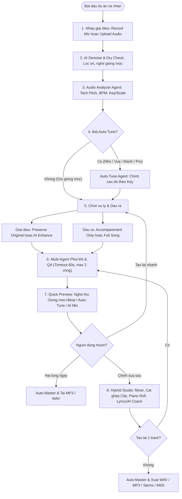

# Tài liệu Đặc tả Yêu cầu Phần mềm (SRS)
## Dự án: AI Music Studio — Hệ thống Sáng tác & Phối khí Âm nhạc Multi-Agent

- **Phiên bản:** 1.4 (SRS Aligned + Multi-Mode AI Chatbot + FL Playlist + Phase 6B/7 Pro DSP)
- **Ngày cập nhật:** 2026-11-25
- **Tài liệu liên quan:** [REQUIREMENTS.md](./REQUIREMENTS.md) | [DESIGN_SPEC.md](./DESIGN_SPEC.md) | [MULTI_AGENT_ARCHITECTURE.md](./MULTI_AGENT_ARCHITECTURE.md) | [API_AND_UI_SPEC.md](./API_AND_UI_SPEC.md)
- **Phạm vi triển khai:** Ứng dụng **cá nhân (Single-User Local App)** — không cần đăng nhập/phân quyền, tối ưu lưu trữ nhẹ ổ đĩa (dùng Redis/RAM cache kết hợp MIDI JSON và dọn file tạm tự động).
- **Phạm vi chức năng:** Đặc tả chi tiết các yêu cầu chức năng (FR), thành phần bắt buộc, ràng buộc kỹ thuật, luồng nghiệp vụ cho **Hum-to-Music**, **AI Denoise & Auto-Tune**, **Lyricist & AI Coach**, **Hybrid MIDI + Audio Clips** và **AI Music Studio (DAW-lite)**.

---

## 1. Tổng quan & Mục tiêu Dự án

### 1.1. Tầm nhìn sản phẩm
Xây dựng một ứng dụng âm nhạc thông minh sử dụng **kiến trúc Multi-Agent**, cho phép người dùng biến một đoạn ngân nga (humming) hoặc bản thu giọng thô thành một đoạn nhạc nền hoàn chỉnh hoặc một bài hát đầy đủ cấu trúc, đồng thời cung cấp công cụ chỉnh phô (Auto-Tune) và phòng thu đa lớp (Music Studio) ngay trên một nền tảng thống nhất.

### 1.2. Nguyên tắc Trải nghiệm (Dual-Mode UX)
Vì hệ thống phục vụ cả người dùng phổ thông lẫn người làm nhạc chuyên sâu, giao diện được thiết kế theo mô hình **2 cấp độ**:
1. **Quick Mode (Cơ bản):** Thao tác tối giản (Ghi âm/Upload $\rightarrow$ Chọn mức Auto-Tune $\rightarrow$ Chọn kiểu xử lý & thể loại $\rightarrow$ Nghe thử & Tải về).
2. **Studio / Pro Mode (Nâng cao):** Mở khóa trình trộn đa track (Multi-track Mixer), chỉnh sửa nốt MIDI trên Piano Roll, đổi hợp âm theo ô nhịp, tinh chỉnh sâu Auto-Tune và xuất Stems/MIDI.

---

## 2. Yêu cầu Chức năng Chi tiết (Functional Requirements — Thành phần & Ràng buộc)

Mỗi chức năng dưới đây được đặc tả rõ **3 phần**: (1) Mô tả nghiệp vụ, (2) **Bắt buộc phải có (Inputs / Controls / Outputs)**, và (3) **Ràng buộc & Quy tắc xử lý lỗi (Constraints & Validation)**.

---

### 2.1. `FR-INP` — Đầu vào Âm thanh (Audio Input)
Hệ thống hỗ trợ đồng thời 2 phương thức nhập giai điệu/giọng hát: **Ghi âm trực tiếp** và **Tải file lên**.

| Mã | Yêu cầu | Mô tả chi tiết |
| :--- | :--- | :--- |
| `FR-INP-01` | **Ghi âm trực tiếp (Record)** | Thu âm qua microphone; có nút Record/Pause/Stop/Re-record, đếm nhịp trước (Count-in Metronome 1 ô nhịp tùy chọn), hiển thị waveform và đồng hồ mức âm lượng (VU meter) thời gian thực. |
| `FR-INP-02` | **Tải file lên (Upload)** | Hỗ trợ kéo-thả hoặc chọn file từ thiết bị. Kiểm tra định dạng, dung lượng, thời lượng trước khi đưa vào xử lý. |
| `FR-INP-03` | **AI Denoise & Lọc tạp âm** | Tự động lọc nhiễu nền (tiếng quạt, ồn môi trường) hoặc tách giọng khỏi nhạc lẫn (tùy chọn bật/tắt); giữ nguyên bản mộc chưa lọc (`Raw Unfiltered`) và bản đã lọc (`Denoised Dry`) để người dùng tự nghe kiểm tra. |
| `FR-INP-04` | **Chuẩn hóa & Căn cắt đầu vào** | Chuẩn hóa tần số lấy mẫu, hỗ trợ cắt bỏ khoảng lặng/đoạn thừa đầu-cuối (thủ công hoặc **AI Auto-Trim**) để làm sạch câu ngân nga trước khi phân tích. |

* **Phải có gì (`FR-INP`):**
  * **Record UI:** Nút xin quyền Microphone, bộ chọn thiết bị thu (nếu có nhiều mic), tùy chọn bật/tắt Metronome đếm nhịp + chọn BPM đếm nhịp, thanh waveform trực tiếp, nút nghe lại ngay trước khi xác nhận.
  * **Upload UI:** Vùng kéo-thả file, thanh tiến trình tải lên, thông tin file sau khi đọc (tên file, thời lượng, sample rate).
  * **Kiểm tra Giọng mộc (`Dry Check`):** Công tắc chuyển nhanh giữa **Raw Mộc (chưa lọc)** và **Denoised Mộc (đã lọc ồn)** để kiểm tra xem giọng có còn dính tạp âm hay mất chi tiết không.
  * **Output chuẩn hóa:** File `raw_input.wav` và `dry_denoised.wav` (Mono, 44.1kHz hoặc 48kHz, 16-bit/24-bit PCM) gắn với `project_id`.
* **Ràng buộc & Quy tắc (`FR-INP`):**
  * **Định dạng cho phép:** Chỉ nhận `WAV`, `MP3`, `M4A`, `OGG`, `FLAC`. Từ chối các định dạng khác ngay tại frontend & backend.
  * **Thời lượng hợp lệ:** Tối thiểu **3 giây** (đủ ít nhất 1 câu nhạc/ô nhịp để AI bắt tông & nhịp); tối đa **60 giây** với chế độ Hum-to-Music đầu vào (hoặc **5 phút** nếu upload vocal full để chỉnh Auto-Tune).
  * **Dung lượng tối đa:** Không quá **50 MB** / file upload.
  * **Ràng buộc lọc ồn & tín hiệu:** Nếu sau bước lọc ồn vẫn phát hiện nhiễu nặng hoặc âm lượng toàn file quá nhỏ (`< -50 dBFS`) / vỡ tiếng liên tục $\rightarrow$ cảnh báo người dùng thu lại/chọn file khác, không tự động làm méo giọng quá mức. Nếu trình duyệt từ chối quyền Microphone $\rightarrow$ hiển thị hướng dẫn cấp quyền và gợi ý chuyển sang Upload.

---

### 2.2. `FR-ANA` — Phân tích Giai điệu & Nhịp điệu (Audio Analysis)
Chuyển đổi âm thanh đầu vào thành dữ liệu âm nhạc có cấu trúc cho các Agent phía sau.

| Mã | Yêu cầu | Mô tả chi tiết |
| :--- | :--- | :--- |
| `FR-ANA-01` | **Phát hiện cao độ (Pitch Detection)** | Trích xuất đường cong cao độ (F0) và chuyển thành danh sách nốt nhạc (`pitch`, `start_beat`, `duration_beats`, `velocity`, `confidence`). |
| `FR-ANA-02` | **Phát hiện Nhịp & Tempo** | Ước lượng BPM và loại nhịp (`4/4`, `3/4`, `6/8`); cho phép người dùng bật click track nghe thử để kiểm chứng hoặc sửa BPM tay. |
| `FR-ANA-03` | **Phát hiện Tông & Âm giai (Key/Scale)** | Tự động suy đoán Key & Scale (VD: `C Major`, `A Minor`) kèm điểm tự tin (`confidence score`). |

* **Phải có gì (`FR-ANA`):**
  * Hiển thị tóm tắt kết quả phân tích cho người dùng thấy và sửa trước khi tạo nhạc: **BPM**, **Time Signature**, **Key / Scale**, và **độ dài theo số ô nhịp (Bars)**.
  * Nút **Tap Tempo** hoặc ô nhập BPM thủ công + nút **Nghe thử với Metronome** để kiểm tra độ khớp nhịp.
  * Dữ liệu JSON `raw_melody_midi` lưu trữ chuỗi nốt thô.
* **Ràng buộc & Quy tắc (`FR-ANA`):**
  * **Khoảng BPM hợp lệ:** Giới hạn trong `40 – 220 BPM` (ngoài khoảng này cảnh báo hoặc chia đôi/nhân đôi BPM tự động để tránh lỗi half-time/double-time).
  * **Độ dài nốt tối thiểu:** Lọc bỏ nhiễu ngắn hơn `60 ms` hoặc nốt có độ tin cậy thấp (`confidence < 0.5`) để không sinh nốt rác trong MIDI.
  * **Độ tin cậy Key/Scale thấp:** Nếu `confidence < 0.6` (ví dụ đoạn ngân nga quá ngắn hoặc hát chênh nhiều), hệ thống phải gắn nhãn *"Gợi ý"* và cho phép người dùng chọn lại Key hoặc nhờ `Auto-Tune` kéo về Key mặc định gần nhất.
  * **Khóa bản phân tích:** Khi người dùng đã chỉnh tay BPM hoặc Key, hệ thống phải ưu tiên giá trị người dùng chốt, **không** tự ý ghi đè lại trong các lần Regenerate sau.

---

### 2.3. `FR-AUTOTUNE` — AI Auto-Tune & Pitch Correction
Chỉnh cao độ giọng ngân nga hoặc giọng hát để đúng tông và mượt mà trước hoặc trong khi phối nhạc.

| Mã | Yêu cầu | Mô tả chi tiết |
| :--- | :--- | :--- |
| `FR-ATN-01` | **Bật/Tắt & So sánh A/B** | Cho phép bật/tắt Auto-Tune và chuyển đổi nghe thử ngay giữa bản thu gốc (`Dry`) và bản đã chỉnh (`Wet`). |
| `FR-ATN-02` | **Quick Presets (Cơ bản)** | 4 mức chọn nhanh 1 chạm: **Off**, **Nhẹ (Natural)**, **Vừa (Balanced)**, **Mạnh (Modern/Robotic)**. |
| `FR-ATN-03` | **Pro Controls (Chuyên sâu)** | Tùy chỉnh sâu trong Studio: **Key & Scale**, **Retune Speed (ms)**, **Humanize (%)**, **Dry/Wet Mix (%)**, và **Auto-Follow Project Key**. |
| `FR-ATN-04` | **Đồng bộ tông với nhạc nền** | Tự động cập nhật thang âm tham chiếu khi người dùng đổi Key hoặc hợp âm trong Studio (nếu bật `Auto-Follow`). |

* **Phải có gì (`FR-ATN`):**
  * Công tắc **Enable Auto-Tune** + nút nghe so sánh **Gốc vs Auto-Tune**.
  * **Quick Bar:** 4 nút preset (*Off / Nhẹ / Vừa / Mạnh*).
  * **Pro Panel (trong Studio):** Dropdown chọn Root Note (`C`..`B`), Scale (`Major`, `Minor`, `Pentatonic Major`, `Pentatonic Minor`, `Chromatic`), thanh kéo `Retune Speed`, `Humanize`, `Mix`, và toggle `Auto-Follow Project Key`.
  * Output: File `vocal_autotuned.wav` giữ nguyên độ dài và mốc thời gian `t = 0` so với bản gốc.
* **Ràng buộc & Quy tắc (`FR-ATN`):**
  * **Giới hạn thông số:**
    * `Retune Speed`: từ `0 ms` (kéo nốt tức thì – hiệu ứng robot) đến `200 ms` (rất chậm/tự nhiên).
    * `Humanize`: từ `0%` đến `100%`.
    * `Dry/Wet Mix`: từ `0%` đến `100%`.
  * **Bảo toàn Formant & Nhịp:** Quá trình kéo cao độ **bắt buộc** giữ nguyên tốc độ phát (không làm nhanh/chậm nhịp) và bảo toàn formant giọng hát (tránh giọng bị méo kiểu "chipmunk" khi dịch cao độ ±1–2 bán cung).
  * **Giới hạn dịch nốt tối đa:** Mặc định chỉ kéo nốt về bậc gần nhất trong Scale đã chọn (trong biên độ hợp lý, tránh nhảy quãng 8 bất thường do lỗi bắt pitch).
  * **Không phá hủy bản gốc (Non-destructive):** Mọi thay đổi thông số Auto-Tune chỉ render lại file xử lý từ `raw_input.wav`, tuyệt đối **không** ghi đè lên `raw_input.wav`.

---

### 2.4. `FR-HUM` — AI Hum-to-Music (Biến giai điệu thành âm nhạc)
Luồng sáng tác và phối khí đa tác tử (Multi-Agent) từ giai điệu đầu vào.

#### A. Chế độ xử lý giai điệu
| Mã | Chế độ | Mô tả chi tiết |
| :--- | :--- | :--- |
| `FR-HUM-01` | **Preserve Original Melody** | Giữ nguyên giai điệu ngân nga (hoặc bản đã qua Auto-Tune); chỉ tạo beat, bass, hợp âm và nhạc nền khớp theo giai điệu đó. |
| `FR-HUM-02` | **AI Enhance Melody** | AI chỉnh sửa cao độ, tối ưu nhịp điệu và phát triển mô-típ giai điệu cho hoàn chỉnh, bắt tai hơn. |
| `FR-HUM-03` | **Preview đối chiếu** | Nghe so sánh trực tiếp **Gốc** vs **Preserve** vs **Enhance** trước khi chọn bản đưa vào Studio. |

#### B. Thành phần âm nhạc tạo ra
| Mã | Chế độ | Mô tả chi tiết |
| :--- | :--- | :--- |
| `FR-HUM-04` | **Accompaniment Only (Nhạc nền)** | Chỉ sinh phần đệm: Drums/Beat, Bass, Harmony/Chords (Piano/Guitar/Pad/Synth) khớp với câu ngân nga. |
| `FR-HUM-05` | **Full Song (Bài hát hoàn chỉnh)** | Phát triển câu ngân nga (mặc định đóng vai trò **mô-típ của Chorus**, hoặc đặt ở Verse/Intro theo đề xuất của AI hoặc người dùng chọn) thành cấu trúc đầy đủ (`Intro – Verse – Chorus – Bridge – Outro`), biến tấu nhạc cụ theo cao trào từng đoạn và tùy chọn sinh thêm **Lead Melody (nhạc cụ dẫn giai điệu) + Karaoke Lyric Guide** để người dùng hát đè lên (giữ nhẹ máy; AI hát thành tiếng người để dành mở rộng sau). |

#### C. Tham số phong cách
| Mã | Yêu cầu | Mô tả chi tiết |
| :--- | :--- | :--- |
| `FR-HUM-06` | **Style & Prompt** | Chọn Thể loại, Mood, tùy chọn nhạc cụ ưu tiên và ô mô tả ngắn bằng văn bản (tùy chọn). |

* **Phải có gì (`FR-HUM`):**
  * Bộ chọn bắt buộc 2 chiều: **Chế độ giai điệu** (`Preserve` / `Enhance`) và **Phạm vi đầu ra** (`Accompaniment Only` / `Full Song`).
  * Bộ chọn **Thể loại (Genre)** (ít nhất 6–8 thể loại phổ biến: *Pop, Ballad, Lo-fi, R&B, Hip-hop, EDM, Acoustic, Rock*) + **Mood** + ô nhập **Text Prompt** (tùy chọn).
  * Nếu chọn `Full Song`: Có bộ chọn **Vị trí mô-típ ngân nga** (`Mặc định: Chorus` / `Verse` / `Theo AI đề xuất`), tùy chọn bật/tắt **Tạo Lead Melody / AI Vocal** và thanh chọn thời lượng/cấu trúc (VD: Ngắn ~1 phút hoặc Chuẩn ~2–3 phút).
  * Hiển thị **trạng thái tiến trình Multi-Agent** kèm nút **Hủy tác vụ (Cancel Job)** đang chạy.
* **Ràng buộc & Quy tắc (`FR-HUM`):**
  * **Ràng buộc của `Preserve Original`:** Không được tự ý đổi cao độ quá 1/2 nhịp hoặc thêm nốt mới làm biến dạng giai điệu gốc của người dùng; toàn bộ hợp âm phải xoay quanh để "chiều" theo giai điệu gốc.
  * **Ràng buộc của `AI Enhance`:** Phải giữ lại ít nhất **mô-típ nhận diện cốt lõi** (contour chính) của câu ngân nga gốc, tránh biến thành một bài khác hoàn toàn không còn liên quan đến bản thu ban đầu.
  * **Ràng buộc độ dài của `Accompaniment Only`:** Số ô nhịp phần nhạc nền sinh ra phải khớp chính xác số ô nhịp của đoạn đầu vào (có thể thêm tối đa 1–2 ô nhịp Intro/Outro nhẹ nếu người dùng bật tùy chọn *Count-in/Tail*).
  * **Ràng buộc cấu trúc của `Full Song`:** Bắt buộc có ít nhất 3 phần phân biệt được cao trào (`Intro`, `Verse`, `Chorus` và `Outro`); vị trí đặt mô-típ ngân nga mặc định là `Chorus` (trừ khi người dùng hoặc AI đề xuất đổi).
  * **Ràng buộc kiểm duyệt hòa âm (QA):** Mọi nốt Bass và Harmony sinh ra phải khớp Key/Scale và tiến trình hợp âm tại từng ô nhịp; không cho phép sai lệch BPM giữa các track.
  * **Timeout & Fallback:** Mỗi bước tạo nhạc giới hạn tối đa **60 giây**; nếu vòng lặp QA quá 2 lần vẫn chưa hoàn hảo, hệ thống trả về **bản tốt nhất (Best-effort Fallback)** kèm cảnh báo nhẹ để người dùng tinh chỉnh tiếp trong Studio.
  * **Giới hạn Text Prompt:** Độ dài tối đa **500 ký tự**; lọc bỏ các prompt yêu cầu sao chép tên nghệ sĩ/bài hát có bản quyền cụ thể (thay bằng mô tả phong cách âm nhạc tương đương).

---

### 2.5. `FR-LYRIC` — Sáng tác Lời bài hát & Trợ lý AI Hướng dẫn (Lyricist & Music Coach)
Hỗ trợ viết lời theo giai điệu/nền beat và giải đáp hướng dẫn sáng tác ngay trong quá trình làm nhạc.

| Mã | Yêu cầu | Mô tả chi tiết |
| :--- | :--- | :--- |
| `FR-LYR-01` | **AI Gợi ý / Viết lời** | Dựa vào chủ đề, tâm trạng, ngôn ngữ (Tiếng Việt / Tiếng Anh) và tiết tấu giai điệu/beat để gợi ý lời bài hát chia theo từng đoạn (`Verse`, `Chorus`...). |
| `FR-LYR-02` | **Viết lời trên nền Beat** | Cung cấp khung soạn lời (Lyric Pad) chạy song song khi đang phát beat hoặc loop đoạn nhạc để người dùng tự viết/chỉnh lời theo nhịp. |
| `FR-LYR-03` | **Global AI Music Copilot (24 Tools & Multimodal)** | Trợ lý AI gắn toàn cục trên cả 5 trang (`/`..`/settings`) với **4 chế độ chuyên sâu** (`Producer`, `Hòa âm`, `Viết lời`, `Mix / Tune`), **Mini-RAG `DawPlaybook`**, **SSE Token Streaming** (`/api/coach/chat/stream`), **Multimodal Audio & Voice** (`/api/coach/chat/audio` `<= 10 MB`, `Gửi kèm Vocal`, Mic WAV/Speech), **A/B nghe thử hợp âm** trực tiếp trong khung chat, **24 Tool Actions** (`set_track_mix`, `manage_track`, `apply_drum_groove`, `edit_structure_and_dynamics`, `set_automation`, `separate_stems`, `update_lyrics_lines`, `set_mastering`, `transport_control`, `navigate_route`, `switch_studio_mode`, `create_template`, `export_project`, ...), **Holistic Project Audit** (*"đề xuất mọi thứ"*), **Áp dụng tất cả**, **Hoàn tác 1 chạm**, và lưu bền vững qua `IndexedDB` (`chat_threads`). |

* **Phải có gì (`FR-LYRIC`):**
  * Tab/Panel **Lyrics & AI Coach** gắn cạnh Timeline.
  * Ô nhập chủ đề/từ khóa + chọn Ngôn ngữ (`Tiếng Việt`, `Tiếng Anh`, `Song ngữ`) + nút **Tạo gợi ý lời**.
  * Khung chat ngắn với **AI Coach** có ngữ cảnh sẵn về dự án hiện tại (BPM, Key, Sections, Chords).
* **Ràng buộc & Quy tắc (`FR-LYRIC`):**
  * **Khớp nhịp & cấu trúc:** Lời do AI gợi ý phải chia đúng theo các `Sections` hiện có của bài và ước lượng số âm tiết phù hợp với số nốt/ô nhịp trong đoạn đó.
  * **Không tự ý sửa nhạc khi chỉ hỏi đáp:** Khi người dùng hỏi AI Coach, AI chỉ đưa ra đề xuất hoặc giải thích; chỉ áp dụng thay đổi vào dự án khi người dùng bấm nút xác nhận áp dụng.

---

### 2.6. `FR-STUDIO` — Preview & Hybrid AI Music Studio (A + B + C)
Không gian nghe thử, phối lại và chỉnh sửa đa lớp kết hợp giữa **MIDI (chỉnh nốt/hợp âm)** và **Audio Clips (cắt ghép như DAW thông thường)**.

#### Cấp độ 1: Quick Preview & Regenerate (Cơ bản)
* `FR-STU-01`: Trình phát nhạc có Play/Pause, Seekbar, Loop đoạn, chuyển đổi nhanh giữa **Giọng mộc (chưa/đã lọc ồn) / Auto-Tune / AI Mix**. Cho phép **gắn trực tiếp giọng mộc lên nền beat** để tự kiểm tra độ khớp và tạp âm.
* `FR-STU-02`: Đổi nhanh Genre, Mood, BPM hoặc bấm **Regenerate** toàn bộ bài.
* `FR-STU-03`: Xuất nhanh file mix hoàn chỉnh (`MP3` / `WAV`).

#### Cấp độ 2: Multi-Track / Hybrid Stem Studio (Trung bình)
* `FR-STU-04`: Tách dự án thành các track độc lập, hỗ trợ 2 loại track song song:
  * **Track Audio Clips:** *Vocal/Hum* (kèm Auto-Tune & Denoise) và *Audio Texture / Sample ngoài* (nếu có dùng AI Audio Gen hoặc import thêm).
  * **Track MIDI + Nhạc cụ:** *Lead Melody, Drums, Bass, Harmony/Chords* (dùng bộ tiếng mẫu SoundFont/Sampler chất lượng cao).
* `FR-STU-05`: Hỗ trợ **Mute**, **Solo**, **Volume (0–120%)**, **Pan (-100% L đến +100% R)** cho từng track.
* `FR-STU-06`: **Cắt ghép & Căn chỉnh Clip như DAW:** Cho phép **Split (Cắt đôi)**, **Trim (Cắt ngắn đầu/cuối)**, **Move (Kéo dịch vị trí trên timeline để căn nhịp)**, **Fade In/Out**, **Duplicate/Loop** trên cả Audio Clip và MIDI Clip; kèm nút **AI Auto-Trim / Tighten** để AI tự rút gọn và căn khớp nhịp cho Vocal.
* `FR-STU-07`: **Thu đè lên Beat & AI Kiểm tra Độ khớp (Vocal Overdub + AI Fit Check):** Cho phép bấm **Record Overdub** hát lời/ngân nga trực tiếp đè lên nền beat đang phát (tạo thành clip mới trên track Vocal để nghe kiểm tra). Ngay sau khi thu, **AI Fit Check** tự động phân tích độ lệch nhịp, cao độ phô và cân bằng âm lượng với beat, rồi đưa ra **đề xuất chỉnh sửa cụ thể kèm nút áp dụng nhanh** (VD: dịch nhịp `±ms`, bật Auto-Tune sửa nốt lệch, hoặc chỉnh Gain/EQ).
* `FR-STU-08`: **Per-Track AI Regeneration** — Yêu cầu AI tạo lại **riêng 1 track** hoặc đổi nhạc cụ của track đó (VD: Piano $\rightarrow$ Acoustic Guitar) mà vẫn giữ nguyên các track khác.
* `FR-STU-09`: Xuất gói **Stems** (file audio rời từng track).

#### Cấp độ 3: Pro / DAW-lite Editor & AI Auto-Mastering (Nâng cao)
* `FR-STU-10`: **Piano Roll & MIDI Editor** — Sửa cao độ, độ dài, thêm/xóa nốt, Quantize (`1/4`, `1/8`, `1/16`) trên các track MIDI.
* `FR-STU-11`: **Chord & Section Timeline** — Hiển thị thanh `Sections` (`Intro`, `Verse`, `Chorus`...) và `Chords` theo từng ô nhịp; cho phép sửa hợp âm và đồng bộ lại phần đệm.
* `FR-STU-12`: **AI Auto-Mix & Mastering (Chống vỡ tiếng):** Tự động cân bằng Gain, đặt **Limiter đầu ra**, lách tần số nhẹ giữa Vocal và nhạc đệm; AI tự cảnh báo và đề xuất/tự điều chỉnh nếu phát hiện có track bị quá ngưỡng gây rè/vỡ tiếng.
* `FR-STU-13`: **Lưu & Mở lại Dự án (`.aimusic` + Auto-Restore):** Cho phép lưu toàn bộ dự án thành 1 file nhẹ `.aimusic` (`1–3 MB`) và tự động khôi phục phiên làm việc gần nhất nếu người dùng quên bấm lưu.
* `FR-STU-14`: **MIDI Export** — Xuất file `.mid` từng track hoặc toàn bộ dự án.
* `FR-STU-15`: **Stem Separation (Tách Beat / Vocal):** Cho phép tách bản thu hoặc file ghép thành 2 stem riêng (`vocal` & `accompaniment`) qua `POST /api/studio/separate-stems` (`librosa` HPSS/Mid-Side hoặc Java DSP fallback).
* `FR-STU-16`: **Multi-Param Web Audio Automation & A/B Chord Audition:** Hỗ trợ chuyển đổi & vẽ đường tự động hóa **`DYN | VOL | PAN | FILT | REVERB`** (`TrackState.automation`) chạy realtime trên Web Audio (`AudioParam.linearRampToValueAtTime`), kèm nút **Nghe thử hợp âm** trước khi áp dụng.
* `FR-STU-17`: **Visual Pitch Curve Editor & Hardware WebMIDI:** Chỉnh sửa độ lệch cao độ bán âm (semitone nudge / scale snap) trực quan trong tab **`Auto-Tune DSP`**, và kết nối bàn phím **WebMIDI** (`navigator.requestMIDIAccess`) để ghi nốt trực tiếp trên Piano Roll.
* `FR-STU-18`: **Custom `.sf2` SoundFont Upload:** Nạp bộ tiếng `.sf2` tùy chọn (`<= 50 MB`, xác thực header `RIFF`/`sfbk`) tại `/settings` để FluidSynth render MIDI với âm sắc riêng.

* **Phải có gì (`FR-STUDIO`):**
  * **Header điều khiển chung:** Play/Pause, Stop, Loop Region, đồng hồ thời gian + vị trí ô nhịp (`Bar:Beat`), BPM hiện tại, Key hiện tại, nút **Undo / Redo**, công cụ **Select / Cut (Kéo cắt) / Snap Grid**, nút **Auto-Mix/Master**, nút **Export**.
  * **Chuyển đổi chế độ hiển thị:** Nút chuyển mượt giữa **Quick Mode** và **Studio Pro Mode** mà không làm mất dữ liệu đang mở.
  * **Track List & Mixer:** Mỗi track có Tên, Nhạc cụ (hoặc loại Audio), nút `M` (Mute), `S` (Solo), nút `Lock` (Khóa không cho AI ghi đè), thanh Volume, nút Pan, đồng hồ Peak meter, nút **Regenerate Track** (với track nhạc đệm) hoặc **Auto-Tune / Dry Check / Separate Stems** (với track Vocal).
  * **Pro Panels:** Cửa sổ **Piano Roll** (trục dọc là nốt C1–C7, trục ngang là Bar/Beat, hỗ trợ snap-to-grid + **Hardware WebMIDI**), **Visual Pitch Curve Editor** trong tab Auto-Tune DSP, **Multi-Param Automation** (`DYN/VOL/PAN/FILT/REVERB`), thanh **Chord Track** (kèm **Nghe thử** A/B), và tab **Lyrics / AI Coach**.
* **Ràng buộc & Quy tắc (`FR-STUDIO`):**
  * **Đồng bộ phát đa track:** Sai số lệch pha/nhịp giữa các track khi Play/Loop phải nhỏ hơn **10 ms**; mọi track audio & MIDI đều neo theo chung 1 mốc `Bar 1, Beat 1 (t = 0.000s)`.
  * **Khóa track khi Regenerate cục bộ:** Khi bấm *Regenerate 1 track* (VD: Bass), hệ thống **cấm** làm thay đổi dữ liệu của các track khác (`Vocal`, `Drums`, `Harmony`) trừ khi người dùng chủ động sửa Hợp âm hoặc BPM.
  * **Ràng buộc sửa Hợp âm (Chord Re-arrange):** Nếu người dùng đổi hợp âm trên Chord Timeline, hệ thống phải đánh dấu cảnh báo *"Hòa âm chưa đồng bộ"* cho đến khi người dùng bấm *Cập nhật nhạc đệm* (hoặc tự động đồng bộ các track chưa bị khóa `Lock`), đồng thời cập nhật Key cho Auto-Tune nếu đang bật `Auto-Follow`.
  * **Ràng buộc Chống vỡ tiếng (Anti-Clipping & Mastering):** Dù người dùng kéo volume từng track lên `120%`, Master Bus khi phát và Export **bắt buộc** đi qua Limiter sao cho đỉnh tín hiệu đầu ra không vượt quá **`-1.0 dBFS`** (mục tiêu loudness quanh **`-14 LUFS`**).
  * **Giới hạn Undo/History:** Lưu tối thiểu **50 bước lịch sử** chỉnh sửa gần nhất trong Redis/RAM (`DEFAULT_MAX_UNDO = 50`, đồng bộ Studio client Undo stack) để quay lại khi cần.
  * **Ràng buộc Export:**
    * Không cho phép xuất file nếu **tất cả các track đều đang bị Mute** (cảnh báo người dùng).
    * Xuất `Stems` phải đóng gói thành `.zip` chứa các file `.wav` có **cùng độ dài chính xác** từ `00:00` để khi kéo vào FL Studio/Ableton không bị lệch nhịp.
    * Xuất `MP3` tối thiểu bitrate `192–320 kbps`; `WAV` chuẩn `44.1kHz / 16-bit` hoặc `24-bit`.
    * Xuất `MIDI` (`.mid`) bắt buộc nhúng đủ Meta Events: `Tempo (BPM)`, `Time Signature`, `Key Signature`, và tách đúng từng Channel/Track.

---

## 3. Luồng Hoạt động Tổng thể (End-to-End User Flow)

---

## 4. Yêu cầu Phi chức năng (Non-Functional Requirements)

| Hạng mục | Yêu cầu cụ thể |
| :--- | :--- |
| **Phạm vi sử dụng & Nguồn AI (Single-User + Dual LLM)** | Chạy cục bộ cho cá nhân (`Localhost`), **không cần đăng nhập hay phân quyền**. Hỗ trợ cấu hình song song cả **Gemini API** và **OpenAI API** qua file `.env` hoặc Settings UI (có thể chọn dùng 1 trong 2 hoặc phân vai mỗi Agent dùng 1 nhà cung cấp); **không** tải model LLM nặng về ổ đĩa. |
| **Chống mất bài khi quên lưu & Nhẹ ổ đĩa** | Áp dụng cơ chế **Auto-Save 2 tầng**: (1) **Browser `IndexedDB`** tự động lưu ngầm mỗi 5–10 giây (JSON State + audio thu âm nén nhẹ, giữ tối đa 3–5 dự án gần nhất — mở lại web là khôi phục ngay cả khi tắt máy/quên lưu); (2) **Redis** giữ bản nháp nóng & Undo History trong RAM kèm TTL tự dọn. Hỗ trợ xuất/mở file dự án `.aimusic` (`1–3 MB`), giữ nhạc cụ ở dạng MIDI JSON và chỉ ghi file WAV/MP3 nặng khi bấm Export. |
| **Đồng bộ nhịp & thời gian (Audio-MIDI Sync)** | Mọi track audio (Vocal/Hum, bản thu đè Overdub, Audio Clip) và track MIDI sinh ra phải chung một mốc lưới nhịp (Tempo Grid) và mốc bắt đầu `t = 0`, sai số `< 10 ms`, có bù độ trễ mic khi thu đè lên beat. |
| **Mastering & Bảo vệ tín hiệu** | Tích hợp Limiter trên Master Bus (`Peak <= -1.0 dBFS`) và AI cân bằng Gain để không vỡ tiếng khi trộn nhiều track hoặc xuất file. |
| **Timeout, Hủy & Fallback** | Mỗi job Multi-Agent có timeout tối đa **60 giây**, hỗ trợ nút **Cancel** hủy ngang an toàn. Vòng lặp QA giới hạn tối đa **2 vòng**; nếu hết vòng vẫn chưa hoàn hảo thì trả về **Best-effort Fallback** kèm cảnh báo nhẹ. |

---

## 5. Tiêu chí Nghiệm thu Tổng quát (Acceptance Criteria)
1. Người dùng cấu hình được API Key **Gemini** hoặc **OpenAI** qua `.env`/Settings; ghi âm hoặc upload đoạn ngân nga 15 giây trong phòng có tạp âm nhẹ, bật **AI Denoise**, nghe thử **giọng mộc gắn vào beat**, bật Auto-Tune mức *Vừa*, chọn *Preserve Original + Accompaniment* và nghe được bản phối khớp nhịp, không vỡ tiếng.
2. Người dùng chuyển sang *AI Enhance + Full Song*, hệ thống đặt đoạn ngân nga làm mô-típ **Chorus** trong cấu trúc `Intro - Verse - Chorus - Outro`, hỗ trợ AI gợi ý lời bài hát, cho phép hỏi **AI Coach** tư vấn và **thu hát đè lên beat (Overdub)** để AI Fit Check đề xuất chỉnh nhịp/cao độ.
3. Trong Hybrid Music Studio, người dùng có thể kéo dịch/cắt ngắn clip Vocal cho khớp beat, Mute track Drums, sửa nốt trên Piano Roll, đổi 1 hợp âm ở Chorus, tái tạo riêng track Bass; thử tắt trình duyệt khi chưa bấm Save rồi mở lại vẫn khôi phục được dự án qua `IndexedDB` mà ổ đĩa không bị phình file rác; xuất được đồng thời `.aimusic`, `WAV`, `Stems` và `MIDI`.
